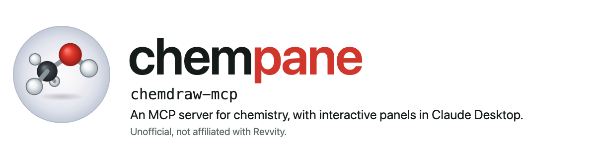
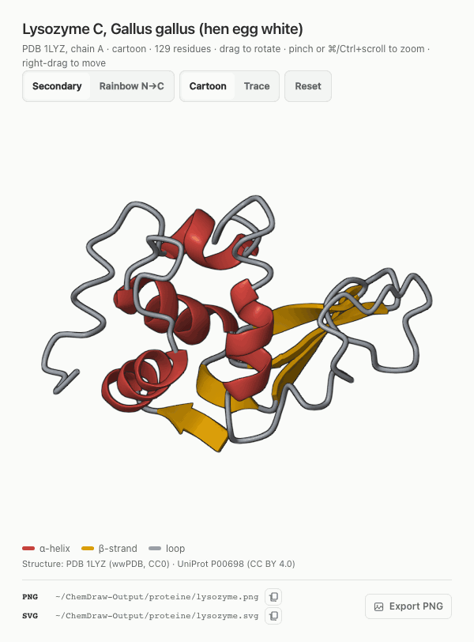
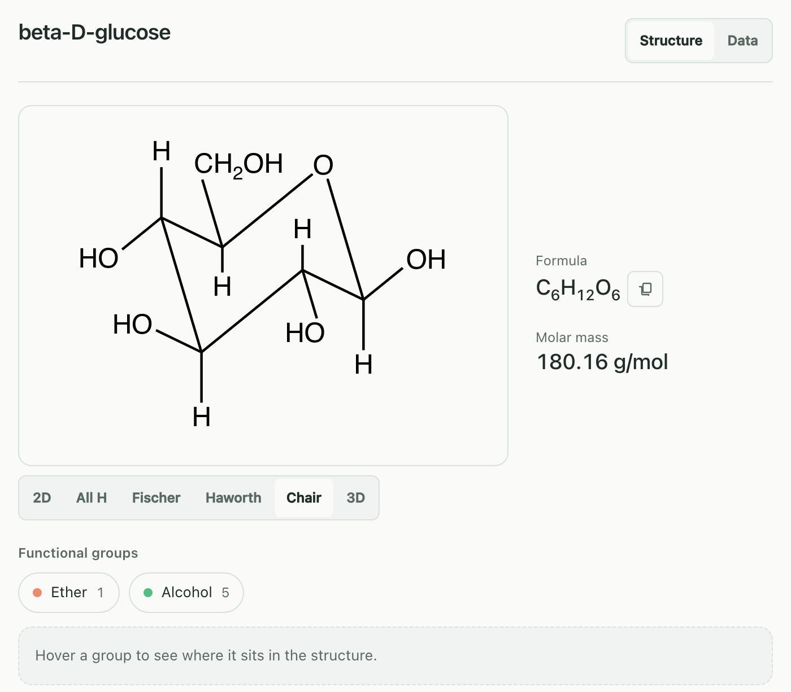
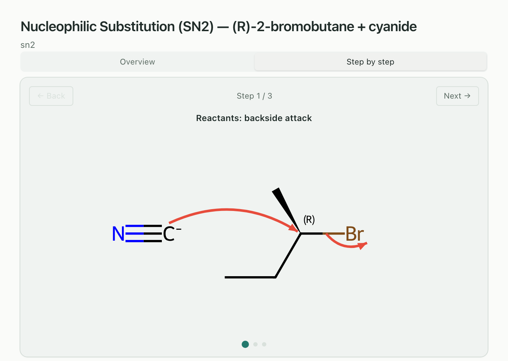
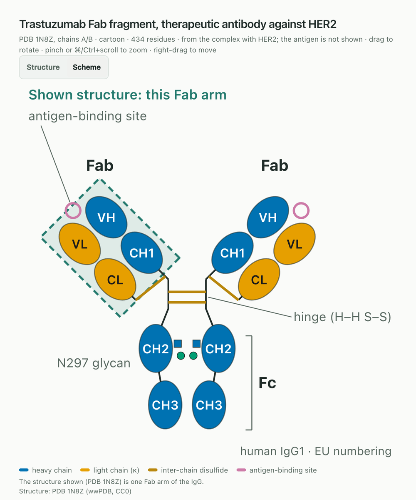
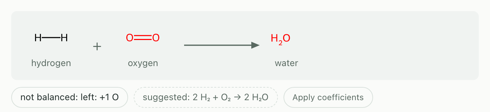
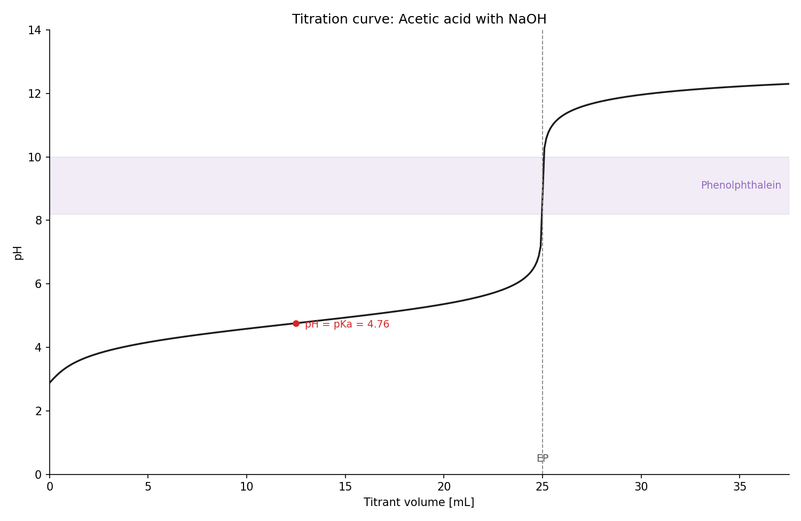
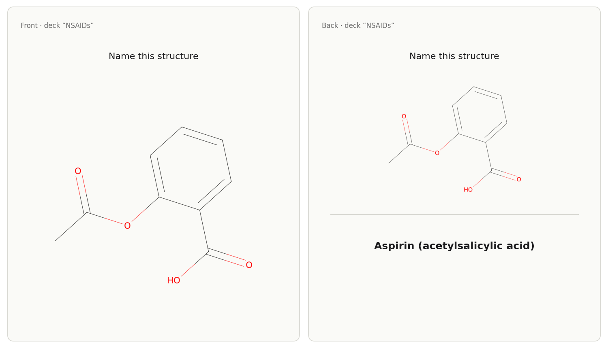

<!-- Kopf: Marke chempane (Logo D2); Paket und Repo heißen weiter chemdraw-mcp. PNG statt SVG, damit die Schrift überall gleich aussieht. -->
<p align="center">
  <picture><source media="(prefers-color-scheme: dark)" srcset="https://raw.githubusercontent.com/jurimaxam-dotcom/chemdraw-mcp/main/assets/readme-kopf-dunkel.png"></picture>
</p>

# chemdraw-mcp

<!-- mcp-name: io.github.jurimaxam-dotcom/chemdraw-mcp -->

[](https://github.com/jurimaxam-dotcom/chemdraw-mcp/actions/workflows/ci.yml)
[](https://github.com/jurimaxam-dotcom/chemdraw-mcp/releases)
[](https://github.com/jurimaxam-dotcom/chemdraw-mcp/blob/main/LICENSE)
[](https://pypi.org/project/chemdraw-mcp/)

**Draw chemical structures in Claude Desktop, explore them in the chat, and export PNG or SVG.**

An MCP server for chemistry, with interactive panels in Claude Desktop.

**Install in Claude Desktop (macOS, Linux):** download
`chemdraw-mcp-<version>.mcpb` from the
**[latest release](https://github.com/jurimaxam-dotcom/chemdraw-mcp/releases/latest)**,
double-click it, confirm, and restart Claude Desktop once.
**Or with [uv](https://docs.astral.sh/uv/)** (uv must be installed):

```bash
uv tool install chemdraw-mcp && chemdraw-install
```

No additional API key or ChemDraw licence. Structures are drawn locally with
RDKit; names, data sheets and proteins are looked up online. Free and open
source (Apache-2.0); unofficial, not affiliated with Revvity.

<!-- Hero: recorded with `npm --prefix chemdraw_tool/ui run readme:gifs` (panel test host, 600 px, light and dark). -->
<p align="center">
  <picture><source media="(prefers-color-scheme: dark)" srcset="https://raw.githubusercontent.com/jurimaxam-dotcom/chemdraw-mcp/main/assets/demo-views-dark.gif"></picture>
  <picture><source media="(prefers-color-scheme: dark)" srcset="https://raw.githubusercontent.com/jurimaxam-dotcom/chemdraw-mcp/main/assets/demo-3d-dark.gif"></picture>
</p>

## Quick start

1. Install as above and restart Claude Desktop once.
2. Open a **new chat** and ask *"Draw caffeine"*.
3. In the panel, hover a functional group, click **3D** for a rotatable
   model, **Data** for the PubChem data sheet, or **Export PNG** to save the
   drawing to `~/ChemDraw-Output/png/`.

Proteins and antibodies come as a cartoon from the PDB or AlphaFold,
rotatable in the panel:

<!-- Aufnahme: `npm --prefix chemdraw_tool/ui run readme:gifs -- lysozyme-cartoon` (Mol*-Cartoon, WebGL) -->
<p align="center"></p>
<p align="center"><sub>Prompt: <i>"Draw lysozyme"</i>. Drag to rotate; colouring, Cartoon/Trace and Reset sit above the picture.</sub></p>

## Gallery

Each picture is real output of the tool the prompt goes to (a panel screenshot
or the written file), not a drawing made for this page. More examples are on
the linked pages.

<table>
<tr>
<td width="50%" valign="top">

**Structure** · [Drawing structures](https://github.com/jurimaxam-dotcom/chemdraw-mcp/blob/main/docs/drawing.md)

```text
Draw the chair conformation of
beta-D-glucose
```



</td>
<td width="50%" valign="top">

**Mechanism** · [Reactions and mechanisms](https://github.com/jurimaxam-dotcom/chemdraw-mcp/blob/main/docs/reactions-and-mechanisms.md)

```text
Show the SN2 mechanism of
(R)-2-bromobutane with cyanide, step by step
```



</td>
</tr>
<tr>
<td width="50%" valign="top">

**Antibody** · [Peptides and proteins](https://github.com/jurimaxam-dotcom/chemdraw-mcp/blob/main/docs/peptides-and-proteins.md)

```text
Draw trastuzumab
```



</td>
<td width="50%" valign="top">

**Reaction** · [Reactions and mechanisms](https://github.com/jurimaxam-dotcom/chemdraw-mcp/blob/main/docs/reactions-and-mechanisms.md)

```text
Draw hydrogen + oxygen → water
as a reaction scheme
```



</td>
</tr>
<tr>
<td width="50%" valign="top">

**Lab graphic** · [Lab graphics](https://github.com/jurimaxam-dotcom/chemdraw-mcp/blob/main/docs/lab-graphics.md)

```text
Titrate 25 mL of 0.1 M acetic acid with
0.1 M NaOH, indicator phenolphthalein
```



</td>
<td width="50%" valign="top">

**Anki** · [Anki decks](https://github.com/jurimaxam-dotcom/chemdraw-mcp/blob/main/docs/anki.md)

```text
Make an Anki card for aspirin
in a deck called NSAIDs
```



</td>
</tr>
</table>

## Installation

Pick **one** route for Claude Desktop. The extension and `chemdraw-install`
register the same connectors, and installing both makes the model see every
tool twice. After installing, restart Claude Desktop once and ask
*"draw caffeine"* in a new chat.

1. **Claude Desktop extension (macOS, Linux):** download
   `chemdraw-mcp-<version>.mcpb` from the
   [latest release](https://github.com/jurimaxam-dotcom/chemdraw-mcp/releases/latest),
   double-click it and confirm in Claude Desktop. The first start downloads
   the dependencies from PyPI, each file checked against hashes pinned at
   release time; later starts are offline.
2. **From PyPI** (needs [uv](https://docs.astral.sh/uv/)):

   ```bash
   uv tool install chemdraw-mcp && chemdraw-install
   ```

3. **From the repository** (to read or change the code):

   ```bash
   git clone https://github.com/jurimaxam-dotcom/chemdraw-mcp.git && cd chemdraw-mcp && ./install.sh
   ```

Something not working? `uvx --from chemdraw-mcp chemdraw-doctor` checks the
installation and prints the fix for each problem. Step-by-step instructions
and the config by hand:
[docs/getting-started.md](https://github.com/jurimaxam-dotcom/chemdraw-mcp/blob/main/docs/getting-started.md)
and [docs/installation.md](https://github.com/jurimaxam-dotcom/chemdraw-mcp/blob/main/docs/installation.md).

**Other clients** (need [uv](https://docs.astral.sh/uv/)):

- **Claude Code:** `claude plugin marketplace add jurimaxam-dotcom/chemdraw-mcp`,
  then `claude plugin install chemdraw-mcp@chemdraw-mcp`.
- **VS Code:** [](https://vscode.dev/redirect?url=vscode%3Amcp%2Finstall%3F%257B%2522name%2522%253A%2522chemdraw-mcp%2522%252C%2522command%2522%253A%2522uvx%2522%252C%2522args%2522%253A%255B%2522chemdraw-mcp%2522%255D%257D)
- **Cursor:** add `{"command":"uvx","args":["chemdraw-mcp"]}` as server
  `chemdraw-mcp` in `mcp.json`, or open
  `cursor://anysphere.cursor-deeplink/mcp/install?name=chemdraw-mcp&config=eyJjb21tYW5kIjoidXZ4IiwiYXJncyI6WyJjaGVtZHJhdy1tY3AiXX0=`
  in the browser.
- **Codex:** `codex mcp add chemdraw -- uvx chemdraw-mcp`

The interactive panel appears in clients that render MCP Apps, such as Claude
Desktop.

### Profiles

Either Claude Desktop route registers **two connectors** from one
installation. They differ only in the profile the server starts with:

| Connector | Profile | Tools | Adds |
|---|---|---|---|
| `chemdraw` | `mvp` (default) | 17, 13 with a panel | the five areas in the [tool table](#tools) |
| `chemdraw-pharma` | `full` | 24, 17 with a panel | substrate-scope figure, calibration curve, pharmacology curves, and calculators for solutions, content determination and pharmacokinetics |

The extension route ships them as two bundles (`chemdraw-mcp-<version>.mcpb`,
`chemdraw-mcp-pharma-<version>.mcpb`); `chemdraw-install` writes both entries
into `claude_desktop_config.json`. In a chat, **enable one connector at a
time** in the connector menu: with both on, the model sees the default tools
twice. Switching between them needs no restart. Details:
[docs/configuration.md](https://github.com/jurimaxam-dotcom/chemdraw-mcp/blob/main/docs/configuration.md).

## Tools

The default profile registers 17 tools, 13 of them with an interactive panel.
Files go to `~/ChemDraw-Output/`.

| Area | Tool | Example prompt |
|---|---|---|
| **Draw** | `generate_molecule` | *"Draw caffeine"* |
| | `batch_generate` | *"Draw adrenaline, noradrenaline and dopamine, each as its own file"* |
| | `compare_molecules` | *"What is the difference between morphine and codeine?"* |
| | `generate_reaction` | *"Draw the esterification of acetic acid with ethanol"* |
| | `generate_mechanism` | *"Show me the SN2 mechanism step by step"* |
| | `generate_3d` | *"Show methane as a rotatable 3D model"* |
| | `generate_protein_or_antibody` | *"Draw lysozyme"*, *"Draw trastuzumab"* |
| **Lab graphics** | `generate_spectrum` | *"Draw the IR spectrum of aspirin"* |
| | `generate_tlc` | *"TLC: educt Rf 0.3, product Rf 0.65, co-spot shows both"* |
| | `generate_titration_curve` | *"Titrate phosphoric acid with NaOH and show the curve"* |
| | `generate_species_distribution` | *"Species distribution of phosphoric acid over pH"* |
| **Look up** | `lookup` | *"What is the CAS number of paracetamol?"* |
| | `lookup_molecule_data` | *"Give me a data sheet for capsaicin"* |
| | `predict_spectrum` | *"Which IR bands should capsaicin show?"* |
| **Calculate** | `calculate_ph` | *"What is the pH of 0.1 M acetic acid, pKa 4.76?"* |
| **Anki** | `export_anki_deck` | *"Make Anki cards with the structures of aspirin, ibuprofen and paracetamol"* |

The 17th tool, `save_png`, is the server half of the panel's export button. It
runs when you click that button and is never called by the model on its own.
Every tool in detail, with its options and limits:
[docs/tools.md](https://github.com/jurimaxam-dotcom/chemdraw-mcp/blob/main/docs/tools.md).

## What leaves your machine

Structures are drawn locally. A SMILES or InChI you type is **not sent to any
database** by default; to fetch its name, CAS number and properties, the server
sends PubChem only the structure's InChIKey, a hash computed on your machine.
The key does not contain the structure; it only matches a record PubChem
already holds. If PubChem has no record for it, those fields stay empty.
Common group abbreviations (`Ph`, `Boc`, `OMe` …) are expanded locally; a
SMILES that still cannot be read is refused, not searched as a name.

Compound names you type are sent to PubChem, NCI and, for enzyme and protein
names, UniProt to resolve them; protein names and gene symbols go to UniProt,
the UniProt accession to PDBe and the AlphaFold DB, the PDB ID to RCSB. A
systematic IUPAC name reveals the structure as much as a SMILES does. To also
search by the SMILES itself, turn on **Look up typed structures by SMILES** in
the extension settings of Claude Desktop, or set `CHEMDRAW_SMILES_LOOKUP=1`.

This holds from version 0.10.0. **Version 0.9.1 and earlier** posted a typed
SMILES to PubChem when PubChem did not know its InChIKey, and `lookup` passed a
typed SMILES or InChI to PubChem, ChEBI, UniProt or KEGG. Details:
[docs/privacy.md](https://github.com/jurimaxam-dotcom/chemdraw-mcp/blob/main/docs/privacy.md).

## Limits

- Lab graphics draw the numbers they are given. For a named compound Claude supplies literature values from memory; check them.
- Curved-arrow mechanisms exist for SN1, SN2 and Fischer esterification only; other reactions get the net scheme.
- Proteins: cartoon without side chains, up to 3000 residues; bound groups such as heme or an inhibitor are shown, water and buffer are not. Peptides from a sequence take up to 20 residues.
- Names, data sheets and proteins need the internet; without Java, systematic IUPAC names do too.
- Claude Desktop often answers knowledge questions from memory; add "use ChemDraw" to the prompt. The extension targets macOS and Linux; Windows is untested.

## Documentation

- [Getting started](https://github.com/jurimaxam-dotcom/chemdraw-mcp/blob/main/docs/getting-started.md): install, first prompt, the panel, where files land, troubleshooting
- [Drawing structures](https://github.com/jurimaxam-dotcom/chemdraw-mcp/blob/main/docs/drawing.md) ·
  [Peptides and proteins](https://github.com/jurimaxam-dotcom/chemdraw-mcp/blob/main/docs/peptides-and-proteins.md) ·
  [Reactions and mechanisms](https://github.com/jurimaxam-dotcom/chemdraw-mcp/blob/main/docs/reactions-and-mechanisms.md) ·
  [Metal complexes](https://github.com/jurimaxam-dotcom/chemdraw-mcp/blob/main/docs/metal-complexes.md)
- [Lab graphics](https://github.com/jurimaxam-dotcom/chemdraw-mcp/blob/main/docs/lab-graphics.md) ·
  [Data and lookup](https://github.com/jurimaxam-dotcom/chemdraw-mcp/blob/main/docs/data-and-lookup.md) ·
  [Anki decks](https://github.com/jurimaxam-dotcom/chemdraw-mcp/blob/main/docs/anki.md)
- [Privacy](https://github.com/jurimaxam-dotcom/chemdraw-mcp/blob/main/docs/privacy.md) ·
  [Configuration](https://github.com/jurimaxam-dotcom/chemdraw-mcp/blob/main/docs/configuration.md) ·
  [FAQ](https://github.com/jurimaxam-dotcom/chemdraw-mcp/blob/main/docs/faq.md)
- Reference: [every tool in detail](https://github.com/jurimaxam-dotcom/chemdraw-mcp/blob/main/docs/tools.md) ·
  [installation](https://github.com/jurimaxam-dotcom/chemdraw-mcp/blob/main/docs/installation.md) ·
  [for developers](https://github.com/jurimaxam-dotcom/chemdraw-mcp/blob/main/docs/for-developers.md) ·
  [development](https://github.com/jurimaxam-dotcom/chemdraw-mcp/blob/main/docs/development.md)

## License and third-party data

Apache-2.0, see [LICENSE](https://github.com/jurimaxam-dotcom/chemdraw-mcp/blob/main/LICENSE). Copyright 2026 jurimaxam-dotcom.

The server builds on and asks:

- [RDKit](https://www.rdkit.org/) (BSD-3-Clause) for parsing, layout, rendering and 3D conformers.
- [Mol*](https://molstar.org/) (MIT; Sehnal et al. 2021) for the protein cartoon in the panel; notices in [THIRD_PARTY_LICENSES](https://github.com/jurimaxam-dotcom/chemdraw-mcp/blob/main/THIRD_PARTY_LICENSES).
- [OPSIN](https://github.com/dan2097/opsin), shipped inside py2opsin, for offline IUPAC names when Java is installed.
- [PubChem](https://pubchem.ncbi.nlm.nih.gov/) and NCI CIR for names, properties and GHS data; ChEBI and KEGG for `lookup`.
- [UniProt](https://www.uniprot.org/) (CC BY 4.0) for protein entries.
- [PDB](https://www.wwpdb.org/) structures (CC0), fetched through PDBe and the RCSB ModelServer, cited with their PDB ID.
- [AlphaFold DB](https://alphafold.ebi.ac.uk/) models (CC BY 4.0; Jumper et al. 2021, Varadi et al. 2024).

Each protein image carries the source line of its structure.

> **Disclaimer:** This is an unofficial, independent project, not affiliated
> with or endorsed by Revvity. *ChemDraw* is a trademark of Revvity Signals
> Software, Inc. This tool does not include or require ChemDraw; it can
> optionally export files in the open CDXML format.

## Contributing

- **Something broke?** [Open a bug report](https://github.com/jurimaxam-dotcom/chemdraw-mcp/issues/new?template=bug_report.yml).
  The form asks for the output of `chemdraw-doctor`.
- **Wrong chemistry?** Use the bug form and name the compound and the figure.
- **Missing something in your course?** [Tell us what you would draw or calculate](https://github.com/jurimaxam-dotcom/chemdraw-mcp/issues/new?template=feature_request.yml).
- **Questions and things you made with it:** [Discussions](https://github.com/jurimaxam-dotcom/chemdraw-mcp/discussions).
- **Code:** [CONTRIBUTING.md](https://github.com/jurimaxam-dotcom/chemdraw-mcp/blob/main/CONTRIBUTING.md)
  and [docs/for-developers.md](https://github.com/jurimaxam-dotcom/chemdraw-mcp/blob/main/docs/for-developers.md).
