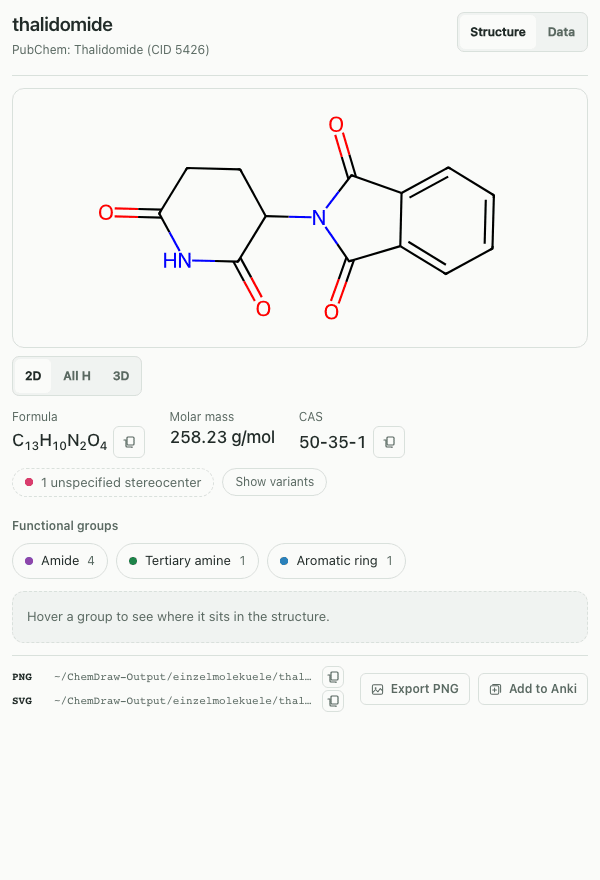
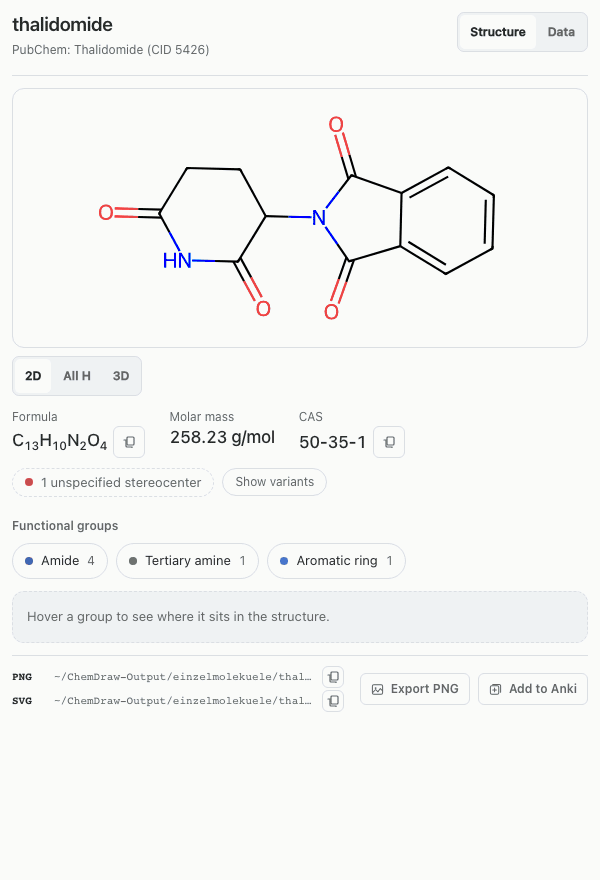
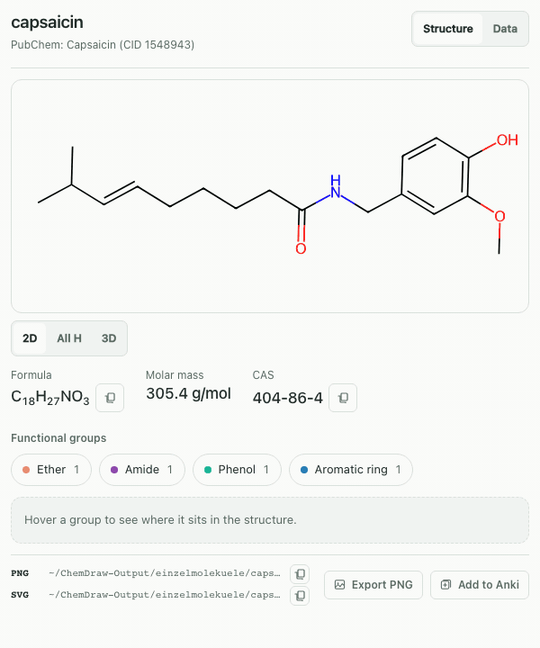

# chemdraw-mcp

<!-- mcp-name: io.github.jurimaxam-dotcom/chemdraw-mcp -->

[](https://github.com/jurimaxam-dotcom/chemdraw-mcp/actions/workflows/ci.yml)
[](https://github.com/jurimaxam-dotcom/chemdraw-mcp/releases)
[](https://github.com/jurimaxam-dotcom/chemdraw-mcp/blob/main/LICENSE)
[](https://pypi.org/project/chemdraw-mcp/)

**Claude draws the chemistry it talks about: structures, reactions, mechanisms and lab graphics, right in the chat.**

Interactive molecule panels in the chat and PNG/SVG files on disk, rendered
locally with RDKit. Free and open source (Apache-2.0). No API key, no
sign-up, no ChemDraw licence.

## Quick start

1. **[Download the Claude Desktop extension](https://github.com/jurimaxam-dotcom/chemdraw-mcp/releases/latest)**
   (`chemdraw-mcp-<version>.mcpb`), double-click it and confirm in Claude Desktop.
2. Open a **new chat** and say *"Use the ChemDraw MCP: draw thalidomide"*.
3. Try one of the [prompts below](#prompts-to-try) or the [tool table](#tools).

Other ways in (PyPI, cloning the repository, editing the config by hand) are
under [Installation](#installation).

<!-- Hero: recorded with `npm --prefix chemdraw_tool/ui run readme:gifs` (panel test host, 600 px, light and dark). -->
<p align="center">
  <picture><source media="(prefers-color-scheme: dark)" srcset="https://raw.githubusercontent.com/jurimaxam-dotcom/chemdraw-mcp/main/assets/demo-views-dark.gif"></picture>
  <picture><source media="(prefers-color-scheme: dark)" srcset="https://raw.githubusercontent.com/jurimaxam-dotcom/chemdraw-mcp/main/assets/demo-3d-dark.gif"></picture>
</p>

## What you get

### A structure you can work with

Ask for thalidomide and the panel shows the skeletal formula, molecular
formula, molar mass and CAS number, plus the PubChem record those numbers
belong to.

- `All H` redraws the molecule with every hydrogen atom. Sugars also get
  `Fischer` and `Haworth` chips where the projection applies.
- Open stereochemistry is flagged, not guessed. Thalidomide's stereocentre
  shows up as "1 unspecified stereocenter".
- `Show variants` draws every stereoisomer (up to three open stereo
  elements). Pick (S) and it is redrawn with wedges.
- A name found under another spelling says so under the title ("Found as").

### 3D in one click

Every structure has a `3D` chip. For morphine, the five fused rings that lie
flat on paper become a rigid cage you can turn.

- The server computes a conformer (RDKit ETKDG plus a force field) and swaps
  the drawing for a ball-and-stick model with explicit hydrogens.
- Drag to rotate. A second click returns to the drawing.
- The conformer is cached, and the SDF file lands in `~/ChemDraw-Output/3d/`.


### Data, flashcards and files

- Hover a functional group of capsaicin (amide, phenol, ether) and its atoms
  light up in the structure, with name and short formula below.
- `Data` turns the panel into the PubChem data sheet with properties and GHS
  hazards. It loads on the first click and then stays cached. This part
  needs the internet.
- `Export PNG` saves the drawing to `~/ChemDraw-Output/png/`; where the host
  allows it, the image also goes to the clipboard.
- `Add to Anki` adds a structure card to the deck "ChemDraw", or saves the
  deck file if Anki cannot take it.
- Every drawing tool also writes PNG and SVG files to `~/ChemDraw-Output/`.
  ChemDraw CDXML on request.

<p align="center"><picture><source media="(prefers-color-scheme: dark)" srcset="https://raw.githubusercontent.com/jurimaxam-dotcom/chemdraw-mcp/main/assets/demo-molecule-dark.gif"></picture></p>

## Prompts to try

- *"Draw thalidomide"*, then click **Show variants** and pick (S).
- *"Show morphine as a rotatable 3D model"*, or draw it and click **3D**.
- *"Draw capsaicin"*, then hover a functional group or click **Data**.

<details>
<summary>More prompts: reactions, mechanisms and lab graphics</summary>

| Prompt | What you get |
|---|---|
| *"Draw thalidomide"* | the structure, then `Show variants` for (R) and (S) |
| *"Show morphine as a rotatable 3D model"* | a ball-and-stick model (`generate_3d`) |
| *"Draw capsaicin and explain why it is poorly soluble in water"* | the structure beside the answer, groups to hover |
| *"Draw adrenaline with all hydrogen atoms"* | the structure opened in the All H view |
| *"Give me a data sheet for lysergic acid diethylamide"* | PubChem properties and GHS hazards (`lookup_molecule_data`) |
| *"What is the difference between testosterone and estradiol?"* | both structures side by side, differences highlighted (`compare_molecules`) |
| *"Draw the nitration of benzene with nitric and sulfuric acid as a reaction scheme"* | reactants, products and conditions on the arrow (`generate_reaction`) |
| *"Show the SN1 mechanism of tert-butyl bromide with water step by step"* | each step with curved electron-flow arrows (`generate_mechanism`) |
| *"Draw a schematic IR spectrum of capsaicin"* | a spectrum from typical literature bands (`generate_spectrum`) |
| *"TLC: educt Rf 0.3, product Rf 0.65, co-spot shows both"* | a TLC plate sketch (`generate_tlc`) |
| *"Titrate 0.1 M acetic acid with 0.1 M NaOH and show the curve with phenolphthalein"* | equivalence point, buffer point and indicator band (`generate_titration_curve`) |
| *"What is the pH of a buffer of 0.1 M acetic acid and 0.05 M sodium acetate?"* | the exact pH with the textbook approximation beside it (`calculate_ph`) |

Curved-arrow mechanisms cover SN1, SN2 and Fischer esterification. For any
other reaction, Claude draws the net scheme and says that the arrow mechanism
is not drawn.

</details>

## Tools

The default profile registers 16 tools, 12 of them with an interactive panel.
Files go to `~/ChemDraw-Output/`. How the model picks the right tool is
explained under [Development](#development).

| Area | Tool | Example prompt | Panel |
|---|---|---|---|
| **Draw** | `generate_molecule` | *"Draw caffeine"* | yes |
| | `batch_generate` | *"Draw adrenaline, noradrenaline and dopamine, each as its own file"* | yes |
| | `compare_molecules` | *"What is the difference between morphine and codeine?"* | yes |
| | `generate_reaction` | *"Draw the esterification of acetic acid with ethanol"* | yes |
| | `generate_mechanism` | *"Show me the SN2 mechanism step by step"* | yes |
| | `generate_3d` | *"Show methane as a rotatable 3D model"* | yes |
| **Lab graphics** | `generate_spectrum` | *"Draw the IR spectrum of aspirin"* | yes |
| | `generate_tlc` | *"TLC: educt Rf 0.3, product Rf 0.65, co-spot shows both"* | yes |
| | `generate_titration_curve` | *"Titrate phosphoric acid with NaOH and show the curve"* | yes |
| | `generate_species_distribution` | *"Species distribution of phosphoric acid over pH"* | yes |
| **Look up** | `lookup` | *"What is the CAS number of paracetamol?"* | text |
| | `lookup_molecule_data` | *"Give me a data sheet for capsaicin"* | yes |
| | `predict_spectrum` | *"Which IR bands should capsaicin show?"* | text |
| **Calculate** | `calculate_ph` | *"What is the pH of 0.1 M acetic acid, pKa 4.76?"* | text |
| **Anki** | `export_anki_deck` | *"I have an exam on NSAIDs on Friday and need to know the structures"* | file |

The 16th tool, `save_png`, is the server half of the panel's export button. It
runs when you click that button and is never called by the model on its own.

What each tool does in detail, the options on the drawing tools (`formats`,
`render_style`, `abbreviate_groups`, `annotate_stereo`) and the known limits:
[docs/tools.md](https://github.com/jurimaxam-dotcom/chemdraw-mcp/blob/main/docs/tools.md).

## Gallery

Every picture below is the tool's own output, generated by
`scripts/readme_bilder.py`.

<details>
<summary>Show the gallery</summary>

<table>
  <tr>
    <td align="center" width="50%"><br><sub><code>generate_spectrum</code></sub></td>
    <td align="center" width="50%"><br><sub><code>generate_titration_curve</code></sub></td>
  </tr>
  <tr>
    <td align="center" width="50%"><br><sub><code>lookup_molecule_data</code></sub></td>
    <td align="center" width="50%"><br><sub><code>calculate_ph</code></sub></td>
  </tr>
  <tr>
    <td align="center" width="50%"><br><sub><code>export_anki_deck</code></sub></td>
    <td align="center" width="50%"><br><sub><code>generate_mechanism</code></sub></td>
  </tr>
  <tr>
    <td align="center" width="50%"><br><sub><code>generate_tlc</code></sub></td>
    <td align="center" width="50%"><br><sub><code>generate_3d</code></sub></td>
  </tr>
</table>

</details>


## Installation

Pick **one** route. The extension and `chemdraw-install` register the same
connectors, and installing both makes the model see every tool twice.
Afterwards restart Claude Desktop and ask *"draw caffeine"*.

- **Claude Desktop extension (macOS, Linux):** download `chemdraw-mcp-<version>.mcpb`
  from the [latest release](https://github.com/jurimaxam-dotcom/chemdraw-mcp/releases/latest),
  double-click it, confirm, restart Claude Desktop once. The first start fetches
  about 40 MB from PyPI, checked against pinned hashes; later starts are offline.
  `chemdraw-mcp-pharma-<version>.mcpb` from the same release adds the second
  connector (see [Profiles](#profiles)); it shares the installation.
- **From PyPI** (needs [uv](https://docs.astral.sh/uv/)):

  ```bash
  uv tool install chemdraw-mcp
  chemdraw-install
  ```

Cloning the repository, editing the config by hand and optional extras (Java
for offline IUPAC names, AnkiConnect):
[docs/installation.md](https://github.com/jurimaxam-dotcom/chemdraw-mcp/blob/main/docs/installation.md).

Something not working? `uvx --from chemdraw-mcp chemdraw-doctor` checks the
installation and prints the fix for each problem.

### Profiles

Either route registers **two connectors** from one installation. They differ
only in the profile the server starts with:

| Connector | Profile | Tools | Adds |
|---|---|---|---|
| `chemdraw` | `mvp` (default) | 16, 12 with a panel | the five areas in the [tool table](#tools) |
| `chemdraw-pharma` | `full` | 23, 16 with a panel | substrate-scope figure, calibration curve, pharmacology curves, and calculators for solutions, content determination and pharmacokinetics |

The extension route ships them as two bundles (`chemdraw-mcp-<version>.mcpb`,
`chemdraw-mcp-pharma-<version>.mcpb`); `chemdraw-install` writes both entries
into `claude_desktop_config.json` (and replaces the single `chemdraw-tool`
entry of earlier versions). In a chat, **enable one connector at a time** in
the connector menu: with both on, the model sees the default tools twice.
Switching between them needs no restart. What the `full` profile adds in
detail: [docs/tools.md#profiles](https://github.com/jurimaxam-dotcom/chemdraw-mcp/blob/main/docs/tools.md#profiles).

## Development

Architecture, setup and the test gate: [docs/development.md](https://github.com/jurimaxam-dotcom/chemdraw-mcp/blob/main/docs/development.md).

## Feedback, bugs and wishes

- **Something broke?** [Open a bug report](https://github.com/jurimaxam-dotcom/chemdraw-mcp/issues/new?template=bug_report.yml).
  The form asks for the output of `chemdraw-doctor`.
- **Missing something in your course?** [Tell us what you would draw or calculate](https://github.com/jurimaxam-dotcom/chemdraw-mcp/issues/new?template=feature_request.yml).
  The subject and the exam question help more than a feature name.
- **Wrong chemistry?** Use the bug form and name the compound and the figure.
- **A question, or something you made with it?** [Discussions](https://github.com/jurimaxam-dotcom/chemdraw-mcp/discussions).
- **It worked for you?** A star on the repository helps other students find it.

## License

Apache-2.0, see [LICENSE](https://github.com/jurimaxam-dotcom/chemdraw-mcp/blob/main/LICENSE). Copyright 2026 jurimaxam-dotcom.

> **Disclaimer:** This is an unofficial, independent project, not affiliated
> with or endorsed by Revvity. *ChemDraw* is a trademark of Revvity Signals
> Software, Inc. This tool does not include or require ChemDraw; it can
> optionally export files in the open CDXML format.
