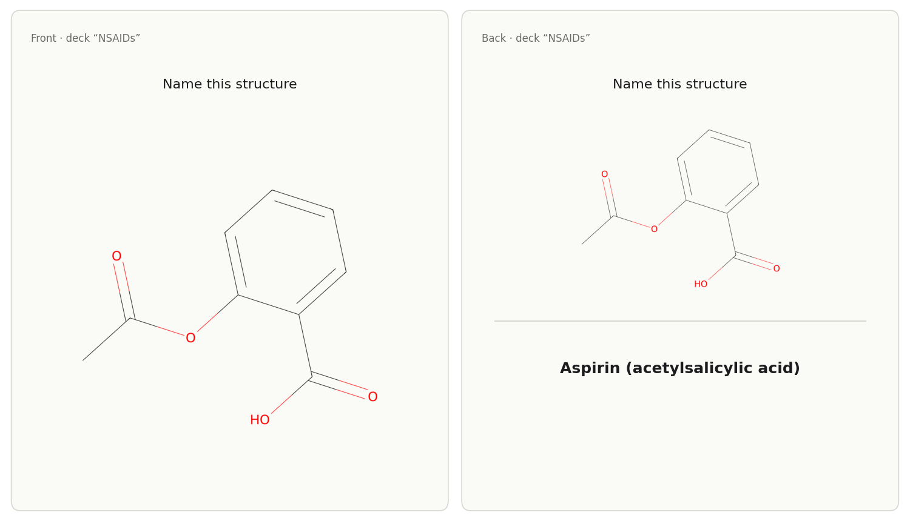

# Anki decks

How to turn structures, reactions and spectra into Anki flashcards, from a
chat prompt or with one click in the panel. The tool is `export_anki_deck`.

## From a prompt

*"I have an exam on NSAIDs on Friday and need to know the structures"*: Claude
offers a deck, writes the cards and the tool renders the images.

The result is an `.apkg` file in `~/ChemDraw-Output/anki/`, named after the
deck. Double-click it to import it into Anki. A test deck with two
structure-to-name cards for ibuprofen and naproxen came back as `nsaids.apkg`
with 2 cards and 2 rendered images.

What a card can hold: text on each side plus at most one picture per side, a
structure (name or SMILES), a reaction scheme or a spectrum. Card types that
work:

- **Structure ↔ name**, optionally in both directions (one note, two cards).
- **Cloze** (fill in the blank).
- **Identity reactions**: the question on the front, the reaction scheme on the
  back.
- **Band assignment**: a spectrum on the front, the assignment on the back.

Tags and subdecks (`Parent::Child`) are supported. Exporting again under the
**same deck name** updates the existing cards instead of adding duplicates; the
front text identifies a card.

## Ready-made decks

Two small starter decks are bundled: *"Give me the analgesics starter deck"*
uses `curated_deck_id`:

- `analgesics-structures`: structure → name for 8 analgesics (NSAIDs,
  paracetamol, morphine, celecoxib). Measured: deck "Common Analgesics —
  Structures", 8 cards.
- `pheur-identity-basics`: classic Ph. Eur. identity tests with reagent,
  observation and reaction scheme.

## One click in the panel

Every molecule panel has **Add to Anki**. It adds a single structure card to
the deck "ChemDraw" and asks the system to open the file in Anki (macOS). If
Anki cannot take it, the deck file is saved and the button says so.

## Straight into a running Anki

With the [AnkiConnect](https://ankiweb.net/shared/info/2055492159) add-on, ask
Claude to deliver the deck via AnkiConnect; the tool then imports it into the
running Anki through `http://127.0.0.1:8765`. Claude does this only when you
ask for it.

## Limits

- Claude writes the card text from its own knowledge. Check it.
- One picture per card side.
- Re-exporting matches cards by their front text; give each card its own
  front if you plan to update the deck.
- Opening in Anki (`open`) is for macOS.
