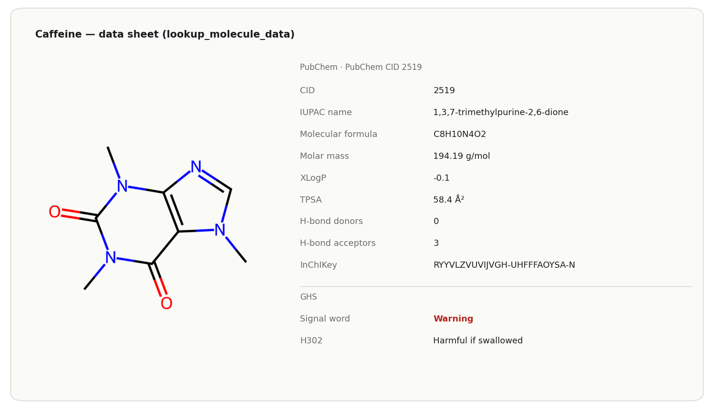

# Data and lookup

How to get a data sheet, a single fact (CAS number, melting point, GHS
hazards, biological role, pathways) or the spectrum a structure should give,
and which source each answer comes from. The tools are
`lookup_molecule_data`, `lookup` and `predict_spectrum`. All lookups need the
internet; `predict_spectrum` works offline once the structure is known.

## Data sheet

*"Give me a data sheet for caffeine"*, or click **Data** in any molecule panel:

`lookup_molecule_data` shows the structure next to the PubChem properties (CID,
IUPAC name, formula, molar mass, XLogP, TPSA, H-bond donors and acceptors,
InChIKey, CAS number) and the GHS classification with its source. For
capsaicin it returned CID 1548943, CAS 404-86-4 and the ECHA C&L
self-classification as the GHS source. In the panel the data sheet loads on
the first click on **Data** and then stays cached.

The CAS number comes from PubChem's CAS section: check digit verified, CAS
Common Chemistry preferred, otherwise the majority of sources. When the sources
disagree evenly, the field stays empty.

## One fact as text: `lookup`

`lookup` answers one question and returns text. Claude picks the topic.

| Topic | Prompt | Source | Measured answer |
|---|---|---|---|
| `properties` | *"What is the CAS number of paracetamol?"* | PubChem | CID 1983, N-(4-hydroxyphenyl)acetamide, C8H9NO2, 151.16 g/mol, CAS 103-90-2 |
| `safety` | *"Which H statements does benzene have?"* | PubChem (GHS) | EU harmonised classification: Danger, H225, H304, H315, H319, H340, H350 … |
| `physical` | *"Melting point of caffeine?"* | PubChem | the experimental properties PubChem records: melting and boiling point, solubility, density, vapour pressure, pKa and more |
| `biochem` | *"What does lysozyme do and what is its EC number?"* | ChEBI, UniProt | hen egg-white lysozyme C, P00698, 129 amino acids, EC 3.2.1.17, function, catalysed reaction |
| `pathway` | *"Which metabolic pathways is glucose in?"* | KEGG | C00031 with 35 pathway links |

- A **typed structure** (SMILES, InChI) is looked up by its InChIKey, as in
  the drawing tools. `lookup` with the aspirin SMILES returned CID 2244.
- A bare run of up to five letters (`PC`, `NOS`, a gene symbol such as `RecA`)
  counts as a name in `lookup`, not as a SMILES, and is sent as typed.
- For a **protein, enzyme or antibody** name, `biochem` returns the UniProt
  data sheet chosen the same way as the drawing (see
  [Peptides and proteins](peptides-and-proteins.md#data-sheet)), with the
  structure that is drawn.

Claude Desktop often answers such questions from memory without calling the
tool (measured 0 of 3 chats each for solubility, IR bands and pH questions).
Add "use ChemDraw" to the prompt when you want the database answer.

## Expected spectra

`predict_spectrum` derives from the structure what a spectrum should show. It
is rule-based (a curated band table matched against the structure), not a
simulation.

| Prompt | Measured answer |
|---|---|
| *"Which IR bands do I expect for aspirin?"* | a table with O–H (acid) 3300–2500 very broad, aromatic C–H 3100–3000, C=O ester 1750–1735, C=O acid 1725–1700, aromatic C=C … with intensity and band shape |
| *"I have a strong band at 1715 cm⁻¹, what can it be?"* | C=O ketone (1725–1705) and C=O carboxylic acid (1725–1700), most likely first, with how to tell them apart |
| *"How many signals does ethyl acetate give in the 1H NMR, and in what ratio?"* | 3 signals for 8 hydrogens, integral ratio 3:3:2 |

No chemical shifts in ppm are given. Protons are counted by topological
symmetry, so diastereotopic protons count as one signal; the answer says so.

## Limits

- Every lookup needs the internet. A missing value is not evidence that a
  property or hazard is absent.
- A typed structure that PubChem has no record for gets no CAS number, logP or
  TPSA; formula and molar mass are computed locally
  ([Privacy](privacy.md)).
- `predict_spectrum`: IR bands and ¹H signal counts only, no ppm values.
- GHS data are what PubChem lists; check the supplier's safety data sheet for
  lab work.
