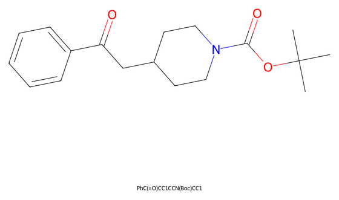
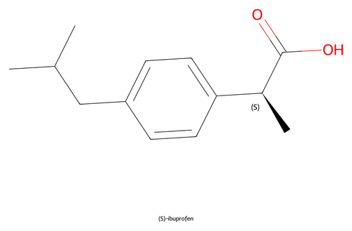
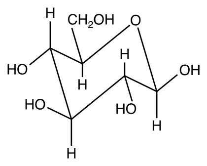
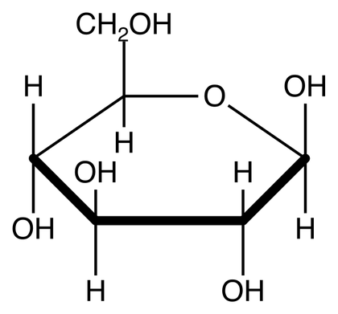
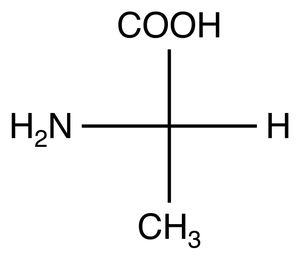
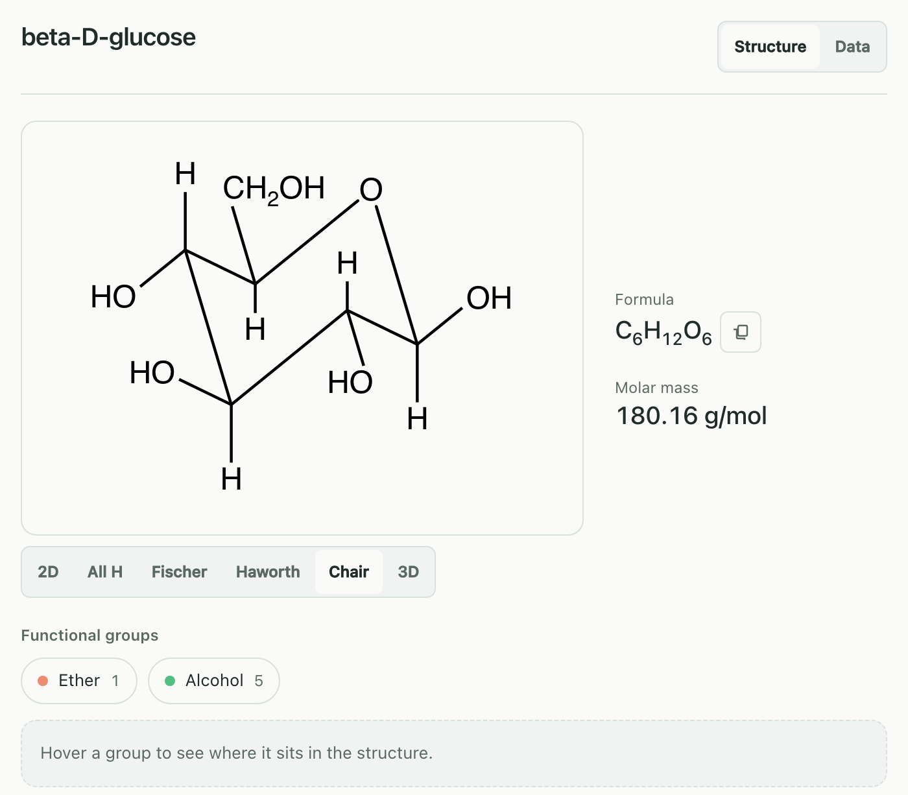
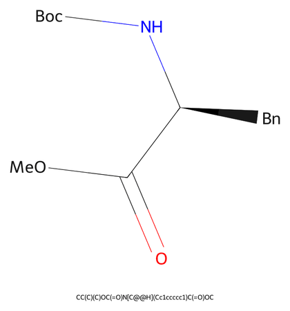
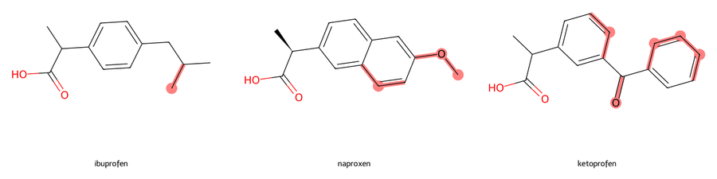

# Drawing structures

How to ask for a structure (names, SMILES, abbreviations, German names), how
stereochemistry is shown, the extra views (All H, Fischer, Haworth, Chair, 3D),
the styles and the file formats. The tools behind this page are
`generate_molecule`, `batch_generate`, `compare_molecules` and `generate_3d`;
the parameter reference is in [tools.md](tools.md#draw).

## Names and SMILES

You can type a compound name or a SMILES. Claude passes it to the server, which
decides as follows:

1. **Whatever RDKit reads as SMILES is a structure.** `O` is water, not oxygen;
   `CCO` is ethanol. InChI, CXSMILES and a SMILES with a label before or after
   it (`CCO batch 7`) count as structures too. A structure is drawn locally.
2. **Everything else is a name.** It is resolved through OPSIN (offline, needs
   Java, systematic IUPAC names), PubChem and NCI CIR, with English, salt, form
   and rotation-sign spellings as fallbacks. Hits are cross-checked against the
   other source.

| Prompt | What came back |
|---|---|
| *"Draw caffeine"* | caffeine, CAS 58-08-2 |
| *"Zeichne Koffein"* (German trivial name) | caffeine, CAS 58-08-2 |
| *"Zeichne Acetylsalicylsäure"* | aspirin, CAS 50-78-2, with "Found as: Acetylsalicylsaeure" under the title |
| *"Draw `PhC(=O)CC1CCN(Boc)CC1`"* | the Boc-protected piperidine below |

**Abbreviations in a SMILES.** Me, Et, Ph, Bn, Ac, Ts, Boc, tBu, OMe and OEt
are expanded locally where their place is unambiguous: at the start, at the end
of the chain or a branch, or alone in parentheses. An input that looks like a
SMILES but still cannot be read is refused with the reason, for example
`C1CC(=O` gets "unbalanced parenthesis: '(' at character 5 is never closed;
ring bond 1 opened at character 2 is never closed". It is not searched as a
name. A reaction SMILES (`CCO>>CC=O`) is refused with a pointer to
`generate_reaction`.

**German names.** Many German trivial names resolve (Koffein, Acetylsalicylsäure,
Häm). The tool descriptions still ask Claude to pass English names,
because the databases index those far better.

**Ambiguous names.** A family name such as "xylene", "cresol", "toluidine",
"butanol" or "glucose" names several compounds. Nothing is drawn; the panel
shows the candidates and draws the one you click. For "xylene" that is o-, m-
and p-xylene.

## Stereochemistry

- **Open stereocentres are flagged, not guessed.** Thalidomide from its name
  comes back with "1 stereocenter is unspecified; the drawing does not fix its
  configuration", and the panel marks the atom.
- **Show variants** (panel) or `stereo_variants` draws every stereoisomer, up to
  three open stereo elements (8 isomers). For thalidomide: (R) and (S). Click one
  to get it with wedges.
- **CIP labels** on the drawing: *"Draw (S)-ibuprofen with R/S labels"* sets
  `annotate_stereo`:

  

- **A SMILES you type keeps its stereo marks exactly.** A mistyped `@`/`@@`
  gives the other enantiomer. The panel's PubChem title and CAS number then
  belong to the structure that was drawn, not to the name you had in mind
  (an (R)-ibuprofen SMILES labelled "(S)-ibuprofen" came back as
  "Ibuprofen, (-)-", CAS 51146-57-7). Check the CIP label or the CAS number.

## Views

Every structure panel has `2D`, `All H` and `3D`. `Fischer`, `Haworth` and
`Chair` appear where they apply. You can also ask for a view directly; Claude
then sets `view` to `all_h`, `fischer`, `haworth` or `chair`.

| Prompt | Result |
|---|---|
| *"Draw the chair conformation of beta-D-glucose"* |  |
| *"Show the Haworth projection of beta-D-glucose"* |  |
| *"Fischer projection of L-alanine"* |  |

- **Chair** takes a single saturated six-membered ring (cyclohexanes,
  pyranoses). Aldohexopyranoses get 4C1 for D and 1C4 for L sugars; other
  rings take the chair with the smaller sum of A-values of the axial groups.
  Fused or spiro rings, a ring double bond, more than one ring or ring
  heteroatoms other than one oxygen are refused with the reason ("'naphthalene'
  has no chair view: its six-membered ring is part of a fused or spiro ring
  system").
- **Fischer** needs a fixed configuration: α-amino acids and sugars
  (aldoses, ketoses, aldonic and uronic acids). A ring sugar ("beta-D-glucose",
  "D-fructose") gets the Fischer projection of its open-chain form, captioned
  "open-chain form"; glycosides have no Fischer view and say why.
- **Haworth** is for sugar rings whose stereocentres are all set; an open
  anomeric centre is drawn as a wavy bond.
- **3D** computes one conformer (RDKit ETKDGv3, then MMFF or UFF) and shows it
  as a ball-and-stick model with explicit hydrogens. Drag to rotate. The SDF
  file goes to `~/ChemDraw-Output/3d/`. `generate_3d` opens the 3D model
  directly (*"Show methane as a rotatable 3D model"*).

The views are drawn in the panel only and write no files; **Export PNG** saves
the view you are looking at to `~/ChemDraw-Output/png/`.

## Styles and abbreviations

- `render_style`: `"compact"` for small figures in a two-column layout,
  `"presentation"` for slides, `"grayscale"` for black-and-white printing. Empty
  means the default look.
- `abbreviate_groups`: draws common substituents as Ph, Bn, OMe, OAc, tBu, CO₂H,
  Boc, Ts, TBS. *"Draw `CC(C)(C)OC(=O)N[C@@H](Cc1ccccc1)C(=O)OC` with
  abbreviated groups"* (Boc-Phe-OMe):

  

  An abbreviated drawing has no All H view and no group highlighting in the
  panel.

## Several structures and comparisons

- *"Draw adrenaline, noradrenaline and dopamine, each as its own file"*:
  `batch_generate` draws each one and reports names it could not resolve.
- *"What is the difference between ibuprofen, naproxen and ketoprofen?"*:
  `compare_molecules` draws two to four structures side by side and highlights
  what differs from the shared scaffold.

## File formats

`generate_molecule`, `batch_generate` and `generate_reaction` write PNG and SVG
by default. Ask for ChemDraw format ("also as CDXML") and Claude adds `"cdxml"`
to `formats`; the CDXML file opens in ChemDraw for further editing. Figures that
are not structures (spectra, TLC plates) refuse CDXML. CDXML is round-trip
validated, but PNG and SVG are the outputs the pixel tests cover.

## Limits

- A name PubChem, NCI and OPSIN do not know is not drawn; pass the SMILES.
- Without Java, systematic IUPAC names are resolved online only.
- A name that resolves to more than 200 heavy atoms is not drawn as a skeletal
  formula; proteins get a cartoon instead
  ([Peptides and proteins](peptides-and-proteins.md)). A SMILES you pass is
  always drawn.
- Chair: one saturated six-membered ring only. Fischer: open chains, and ring
  sugars as their open-chain form; no glycosides.
- The chair view places every substituent axial or equatorial, also when the
  input leaves a stereocentre open; the panel then reports the unspecified
  stereocentres. Pass a SMILES with stereo marks when the conformation matters.
- 3D is one conformer to look at, not a conformational search.
