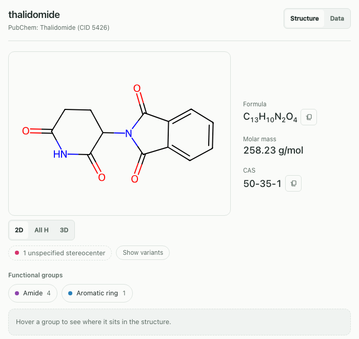

# Getting started

How to install chemdraw-mcp for Claude Desktop, what your first prompt shows,
where the files go and what to do when nothing happens.

## Install

Pick **one** route. The extension and `chemdraw-install` register the same two
connectors; installing both makes the model see every tool twice.

### Route 1: Claude Desktop extension (macOS, Linux)

1. Download `chemdraw-mcp-<version>.mcpb` from the
   [latest release](https://github.com/jurimaxam-dotcom/chemdraw-mcp/releases/latest).
2. Double-click the file and confirm the installation in Claude Desktop.
3. Restart Claude Desktop once.

The first start installs the package from PyPI with [uv](https://docs.astral.sh/uv/),
every file checked against hashes pinned at release time. That is about 40 MB
and takes a minute; later starts are offline. If uv is missing, the extension
downloads a fixed uv version and checks its SHA-256.

`chemdraw-mcp-pharma-<version>.mcpb` from the same release is the second
connector with the `full` profile (see [Configuration](configuration.md)).
Both bundles share one installation on disk.

If your organisation manages Claude Desktop, extensions may be blocked or
limited to a list. Use route 2 then.

### Route 2: from PyPI

Needs uv:

```bash
uv tool install chemdraw-mcp && chemdraw-install
```

`chemdraw-install` writes both connectors (`chemdraw` and `chemdraw-pharma`)
into `claude_desktop_config.json` with the absolute path of the installed
launcher, backs up the file first (`.bak`), leaves other MCP servers alone and
prints what it wrote. Restart Claude Desktop afterwards.

### Route 3: from the repository

```bash
git clone https://github.com/jurimaxam-dotcom/chemdraw-mcp.git && cd chemdraw-mcp && ./install.sh
```

`install.sh` installs uv if it is missing (fixed version, SHA-256 checked),
runs `uv sync --locked`, registers both connectors the same way
`chemdraw-install` does and checks that the server imports. Restart Claude
Desktop afterwards.

Editing the config by hand and the optional extras (Java for offline IUPAC
names, the AnkiConnect add-on) are in [installation.md](installation.md).

## Your first prompt

Open a **new chat**, make sure the `chemdraw` connector is switched on in the
connector menu, and type:

> Draw thalidomide



What the panel shows:

- **Title and source.** The name you asked for and the PubChem record the
  numbers come from ("PubChem: Thalidomide (CID 5426)"). If the name was found
  under another spelling, a "Found as" line says which.
- **Drawing buttons.** `2D`, `All H` and `3D` for every structure; `Fischer`,
  `Haworth` and `Chair` where the projection applies (see
  [Drawing structures](drawing.md#views)).
- **Formula, molar mass, CAS number**, each with a copy button.
- **Stereochemistry.** Open stereocentres are flagged ("1 unspecified
  stereocenter"), not guessed. **Show variants** draws every stereoisomer.
- **Functional groups.** Hover a group and its atoms light up.
- **Structure / Data.** `Data` turns the panel into the PubChem data sheet with
  properties and GHS hazards (needs the internet; loaded on the first click).
- **Footer.** The paths of the PNG and SVG files, **Export PNG** and
  **Add to Anki**.

Six more prompts with their results are in the
[README gallery](../README.md#gallery).

## Where the files go

Everything lands under `~/ChemDraw-Output/`. The folder is created on the first
drawing; there is no setting to move it. Some subfolder names are German.

| What | Folder |
|---|---|
| Single structures (`generate_molecule`, `batch_generate`) | `~/ChemDraw-Output/einzelmolekuele/` |
| Reaction schemes (`generate_reaction`) | one folder per scheme, e.g. `~/ChemDraw-Output/reaktion-09aafa/` |
| Proteins and antibodies, IgG scheme | `~/ChemDraw-Output/proteine/` |
| 3D conformers (SDF) | `~/ChemDraw-Output/3d/` |
| Spectra | `~/ChemDraw-Output/spektren/` |
| TLC plates | `~/ChemDraw-Output/dc-platten/` |
| Titration curves, species distributions, comparisons | `~/ChemDraw-Output/diagramme/` |
| Anki decks (`.apkg`) | `~/ChemDraw-Output/anki/` |
| The panel's **Export PNG** button | `~/ChemDraw-Output/png/` |
| Server log | `~/ChemDraw-Output/server.log` |

Not every result is a file. Mechanisms, the extra drawings (All H, Fischer,
Haworth, Chair) and a rotated 3D view exist only in the panel; **Export PNG**
saves the one you are looking at.

## Troubleshooting

Run the doctor first. It prints one line per check and the command that fixes
each problem:

```bash
chemdraw-doctor                            # after route 2
uv run chemdraw-doctor                     # in a clone (route 3)
uvx --from chemdraw-mcp chemdraw-doctor    # without installing anything
```

It checks seven things: RDKit rendering, the Java runtime for OPSIN, the `uv`
launcher, the Claude Desktop entry, whether PubChem and NCI are reachable, the
SMILES lookup setting and the output folder. Results are `[OK]`, `[LIMITED]`
(works, but restricted), `[FAIL]` or `[NOTE]` (does not apply). The exit code
stays 0 while the server is usable. With the extension installed, the Claude
Desktop check reports `[NOTE]`: extensions are managed by Claude Desktop and do
not appear in its config file.

### Stumbling block 1: no restart

Claude Desktop starts the server once and keeps the process running. After an
installation or an update, quit Claude Desktop completely (on macOS Cmd-Q, not
just closing the window) and open it again. An old process mixed with new files
fails in confusing ways; a missing panel after installing an extension is the
usual sign.

### Stumbling block 2: tool permissions in Claude Desktop

Claude Desktop keeps a permission per tool under Settings → Connectors →
`chemdraw`. A tool that needs approval shows a dialog in the chat ("Claude wants
to use … from chemdraw") and waits until you click. A tool set to **blocked**
is not offered to the model at all: Claude then answers from memory or says it
has no such tool, and nothing in the chat says why. Newly added tools can start
out blocked. If a tool never runs, open that list first.

More questions from real use: [FAQ](faq.md).

## Limits

- The extension targets macOS and Linux. Windows is untested.
- Name resolution, data sheets and proteins need the internet. Drawing a
  SMILES or a peptide sequence works offline.
- The first start of the extension needs the internet (about 40 MB from PyPI).
- The output folder is fixed at `~/ChemDraw-Output/`.
