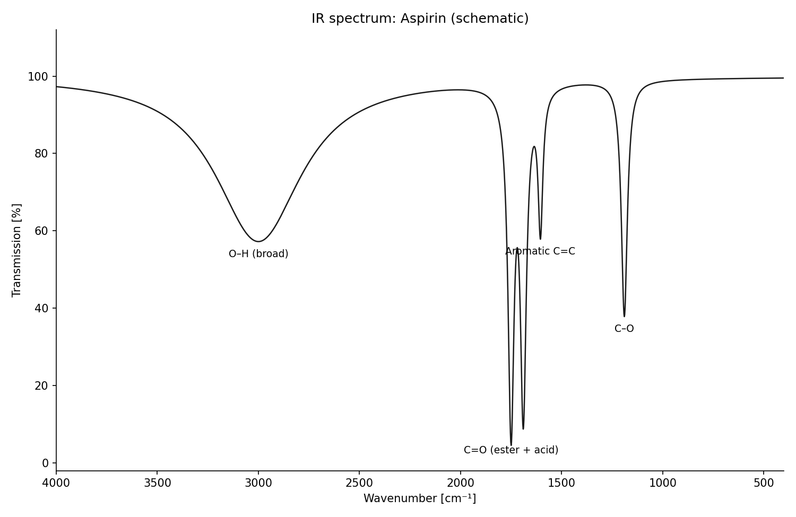
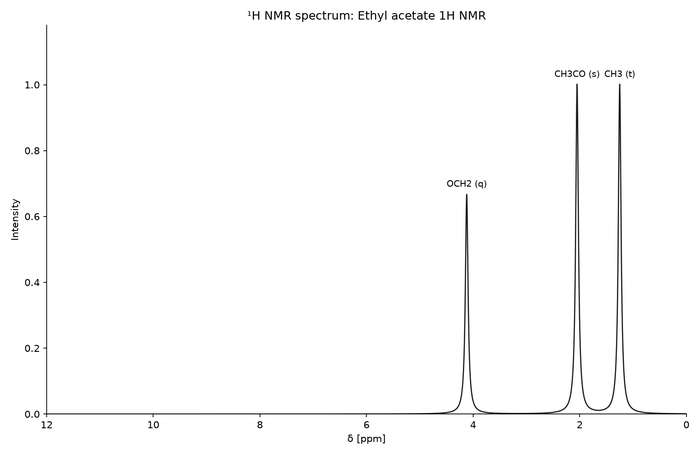
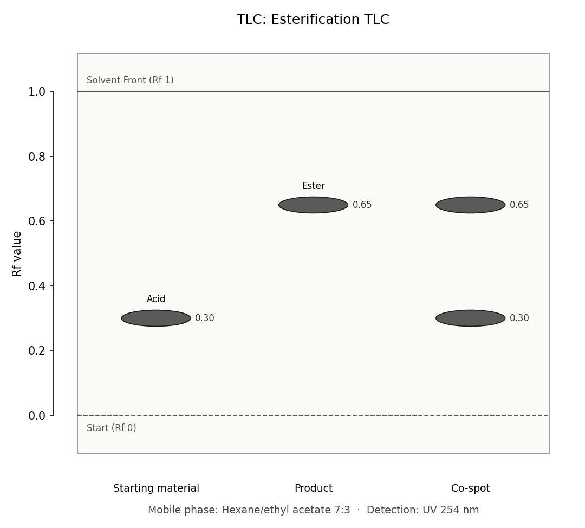
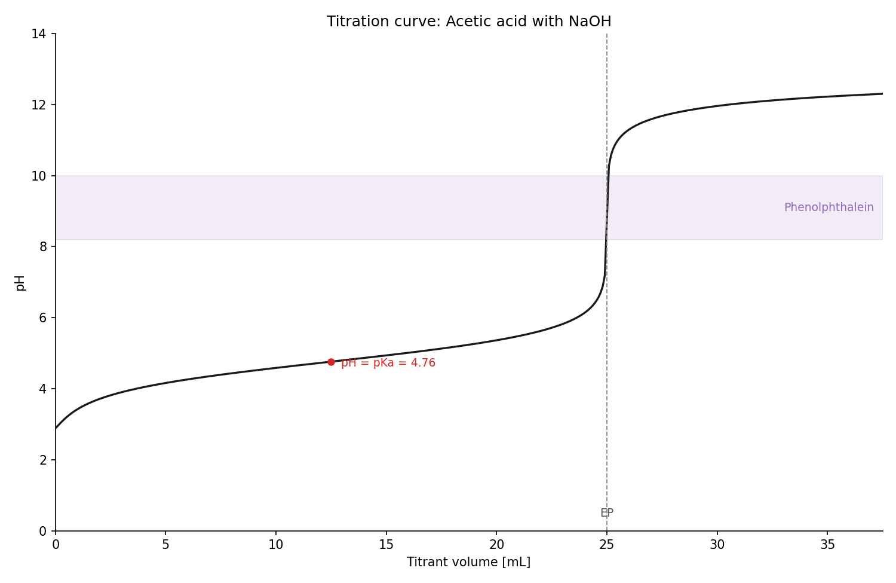
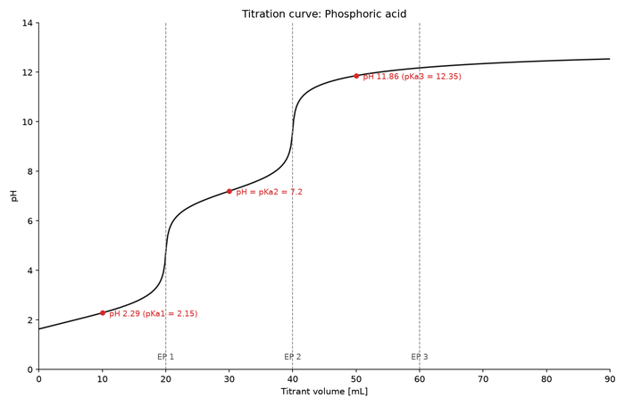
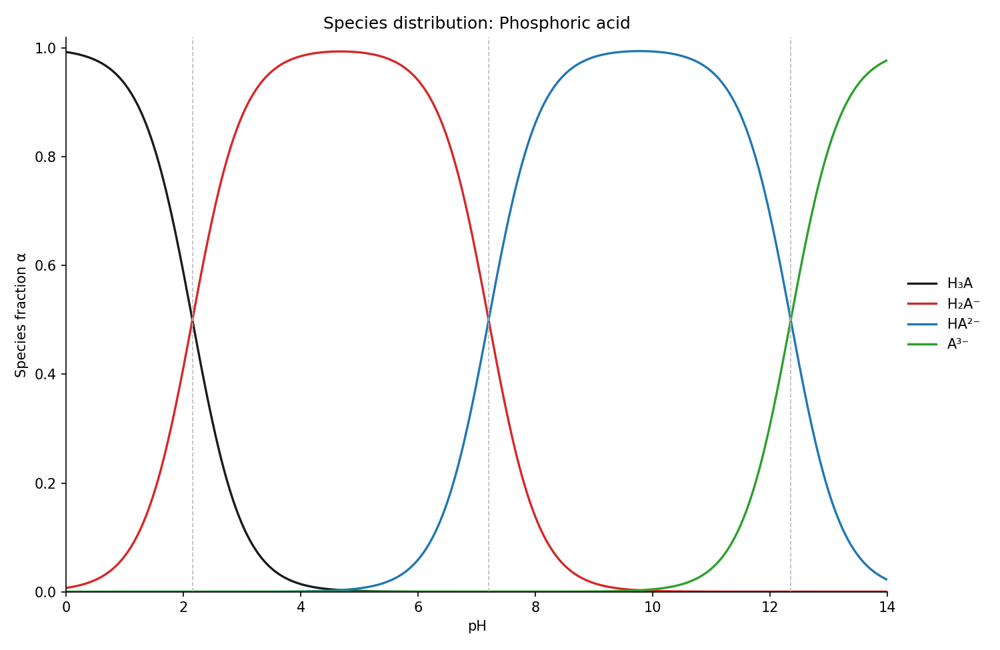
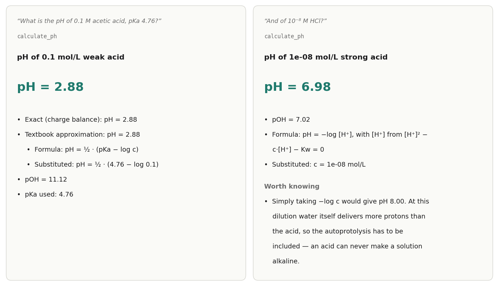

# Lab graphics

Schematic spectra, TLC plates, titration curves, species distributions and pH
calculations from the default profile, and what the `full` profile adds.
These tools draw the numbers they are given. For a named compound Claude
supplies typical literature values from memory: check them before they go
into a report.

## Spectra

`generate_spectrum` draws IR, NIR, Raman, UV/Vis, fluorescence, ORD, CD,
¹H NMR, ¹³C NMR and mass spectra from a peak list, each with its axis
convention: inverted wavenumber axis for IR, ppm from right to left for NMR,
bars for MS.

| Prompt | Result |
|---|---|
| *"Draw the IR spectrum of aspirin"* |  |
| *"Draw a 1H NMR of ethyl acetate"* |  |

Peaks are drawn as lines of a given position, intensity and width. Splitting
patterns, coupling constants and isotope patterns are not simulated; a label
such as "CH3 (t)" is text. Which bands or how many ¹H signals a structure
should give is a different question, answered by `predict_spectrum`
([Data and lookup](data-and-lookup.md#expected-spectra)).

## TLC plates

*"TLC: educt Rf 0.3, product Rf 0.65, co-spot shows both, hexane/ethyl acetate
7:3, UV 254 nm"*:

`generate_tlc` draws start line, solvent front, one labelled lane per
application point, the Rf value at every spot, and mobile phase and detection
as a caption. The tool takes Rf values; if you give distances ("spot 2.1 cm,
front 6.0 cm"), Claude has to convert them, so check the numbers on the plate.

## Titration curves and species distributions

| Prompt | Result |
|---|---|
| *"Titrate 0.1 M acetic acid with 0.1 M NaOH and show the curve with phenolphthalein"* |  |
| *"Titrate 20 mL 0.1 M phosphoric acid with 0.1 M NaOH"* |  |
| *"Species distribution of phosphoric acid over pH"* |  |

- `generate_titration_curve` computes pH against titrant volume from the exact
  charge balance, for a weak or polyprotic acid titrated with a strong base. It
  marks every equivalence point, the buffer points and, if you name an
  indicator with its range, the transition band. For phosphoric acid the third
  equivalence point is marked but shows no jump, as in a real titration in
  water.
- `generate_species_distribution` plots the fraction of each protonation
  species from pH 0 to 14.
- You supply the pKa values (Claude does from memory if you don't). They must
  be in ascending order.

## pH as a number

*"What is the pH of 0.1 M acetic acid, pKa 4.76?"* and
*"And of 10⁻⁸ M HCl?"*:

`calculate_ph` covers weak and strong acids and bases, buffers (pH, ratio and
capacity), buffer recipes and the ionised fraction of a drug at a given pH. It
solves the same charge balance as the titration curve and prints the textbook
approximation beside it. Measured answers:

| Question | Answer |
|---|---|
| 0.1 M acetic acid, pKa 4.76 | pH 2.88 (approximation 2.88) |
| buffer 0.1 M acetic acid + 0.05 M acetate | pH 4.46, buffer capacity 0.0768 mol/(L·pH) |
| 10⁻⁸ M HCl | pH 6.98, with the note that −log c would give 8.00 |
| ibuprofen (pKa 4.4) at pH 1.5 | 99.87 % uncharged |
| 100 mL 0.1 M buffer pH 7.4, pKa 7.2 | base : acid 1.58 : 1, 0.003869 mol acid and 0.006131 mol base; with the molar masses it gives grams |

Claude Desktop often answers a pH question from memory without calling the
tool. Add "use ChemDraw" to the prompt to get the worked answer.

## Only in the full profile

The `full` profile (connector `chemdraw-pharma`) adds seven tools. To use them,
install the second bundle or run `chemdraw-install`, and switch to
`chemdraw-pharma` in the connector menu; with your own config set
`CHEMDRAW_PROFILE=full` ([Configuration](configuration.md)).

- `generate_calibration_curve`: least-squares line, unknowns read back,
  LOD/LOQ (ICH Q2 estimate).
- `generate_pk_curve` and `generate_dose_response`: plasma concentration over
  time and the Hill curve with a competitive antagonist.
- `generate_scope_table`: the substrate-scope figure of a methods paper.
- `calculate_solution`, `calculate_content`, `calculate_pharmacokinetics`:
  weighing and dilution, content determinations (titration, photometry,
  Grubbs test, fat values, Karl Fischer) and pharmacokinetic numbers.

Details and pictures: [tools.md](tools.md#profiles).

## Limits

- The figures measure nothing. A spectrum or TLC plate shows the values passed
  in; TLC spot intensity is a drawing hint, not densitometry.
- Labels of close peaks that would overlap (1750 and 1690 cm⁻¹) are set side
  by side with thin leader lines to their bands; very crowded spectra stay
  hard to read.
- Titration curves cover acids titrated with a strong base.
- `calculate_ph` works with concentrations, not activities; at high
  concentrations it says so.
