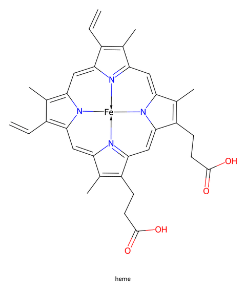
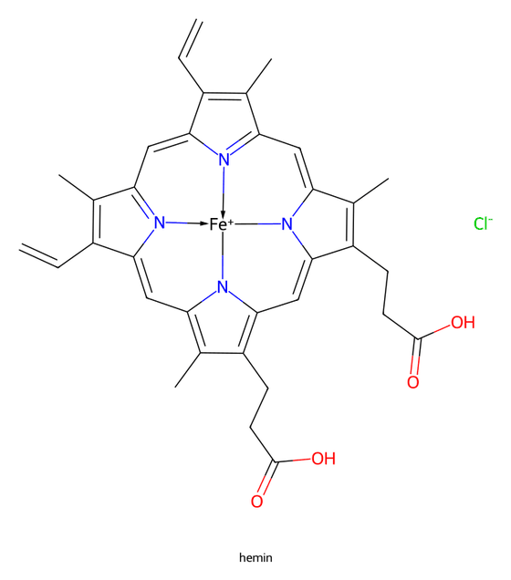
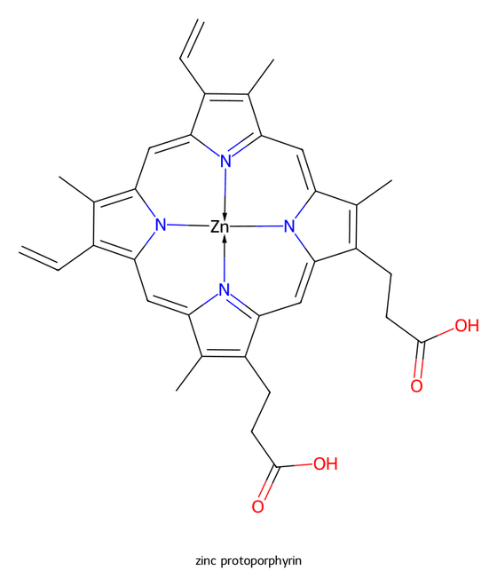
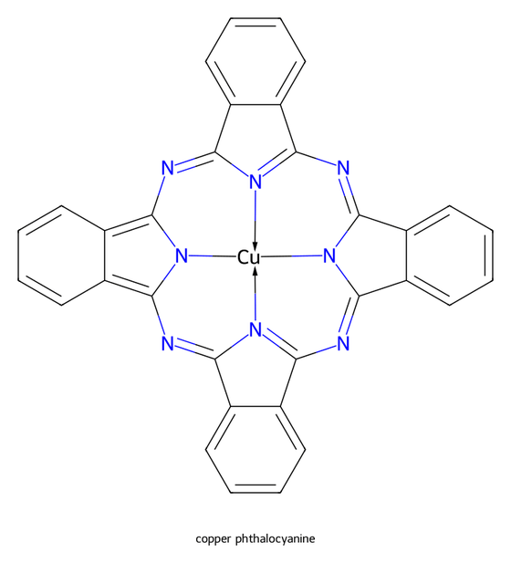
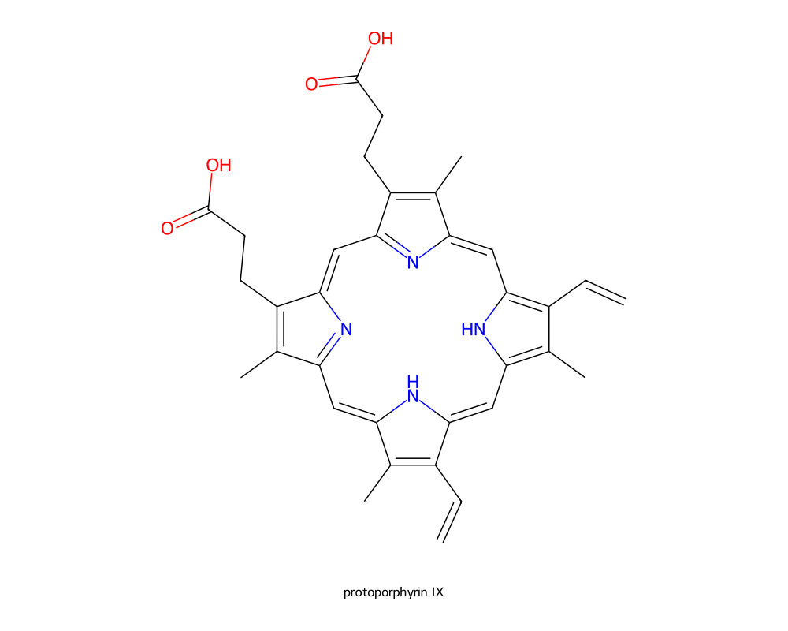
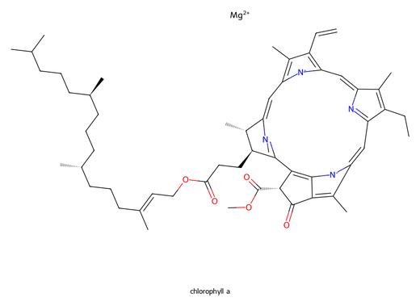

# Metal complexes

How heme, hemin and related metal tetrapyrroles are drawn, and which
complexes keep the plain database drawing.

## Metal tetrapyrroles

Heme b, hemin, zinc protoporphyrin, copper phthalocyanine and related
complexes are drawn as in a textbook: an undistorted macrocycle with
the metal in the centre, bonded to the four ring nitrogens.

| Prompt | Result |
|---|---|
| *"Draw heme b"* (also "heme", "Häm", "protoheme") |  |
| *"Draw hemin"* |  |
| *"Draw zinc protoporphyrin"* |  |
| *"Draw copper phthalocyanine"* |  |

- **Bonds to the metal.** A ring nitrogen anion paired with a positive metal
  charge is drawn as a plain bond (the charges cancel); any other nitrogen as a
  dative arrow N→M. Heme b thus shows two lines, two arrows and no charges;
  hemin, with Fe⁺ and a chloride counter-ion, one line and three arrows.
- **The bonds exist only in the drawing.** Formula, InChIKey, CAS number and
  the SMILES the data sheet uses are those of the database record, which lists
  the metal as a separate ion. The CDXML file keeps the record's bonds, with
  the metal placed in the centre.
- **Fixed structures.** Heme b and hemin resolve offline to fixed
  structures in one notation, independent of which PubChem record a name
  points to that day.

## Without a metal

*"Draw protoporphyrin IX"* gives the same undistorted ring, with two NH
groups; metal-free phthalocyanine too. Metal-free porphine does not: it was
drawn with a distorted macrocycle.

## What keeps the old drawing

When the macrocycle layout would cross or stretch bonds, the drawing stays as
it comes from the database layout: chlorophyll a, bacteriochlorophyll a and
cyanocobalamin were measured. There the metal ion floats beside the ring
(for cyanocobalamin the cyanide too).

## Limits

- Only tetrapyrroles get the centred-metal layout. Other coordination
  compounds are drawn as their database record lists them. Measured: cisplatin
  comes out as a straight Cl–Pt–Cl with two separate NH₃ (the drawing shows
  neither cis nor trans geometry); ferrocene as two cyclopentadienyl radicals
  and a separate Fe atom. Use such pictures only with that in mind.
- Chlorophylls and cyanocobalamin keep the plain layout.
- PubChem titles can be odd: hemin came back with the title "Npc76529".
- Proteins that carry a heme (myoglobin, haemoglobin, catalase) are drawn as
  a cartoon with the bound heme drawn in its pocket and named in the legend
  ([Peptides and proteins](peptides-and-proteins.md)); the centred-metal
  layout applies only to the skeletal formula of a tetrapyrrole.
