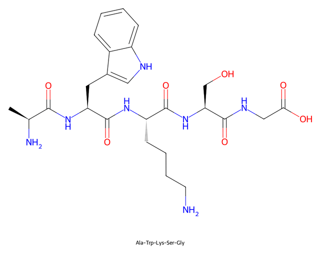
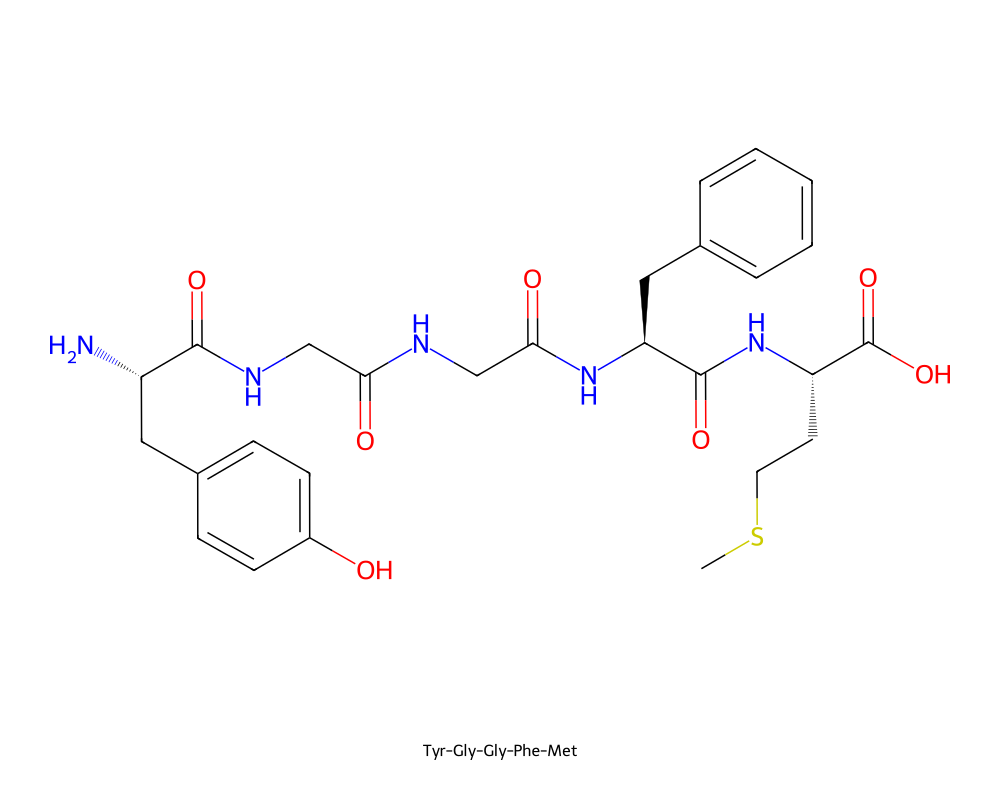
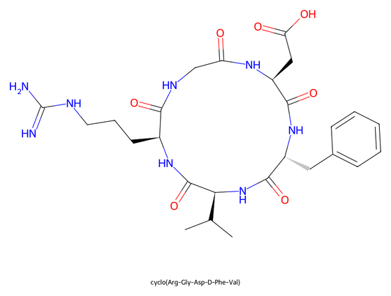
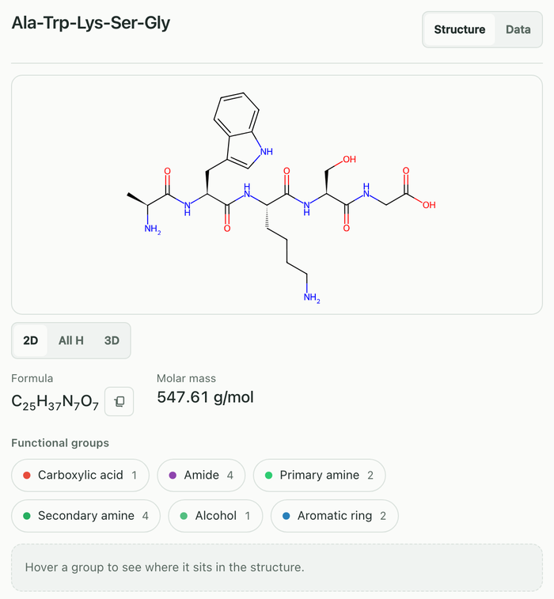
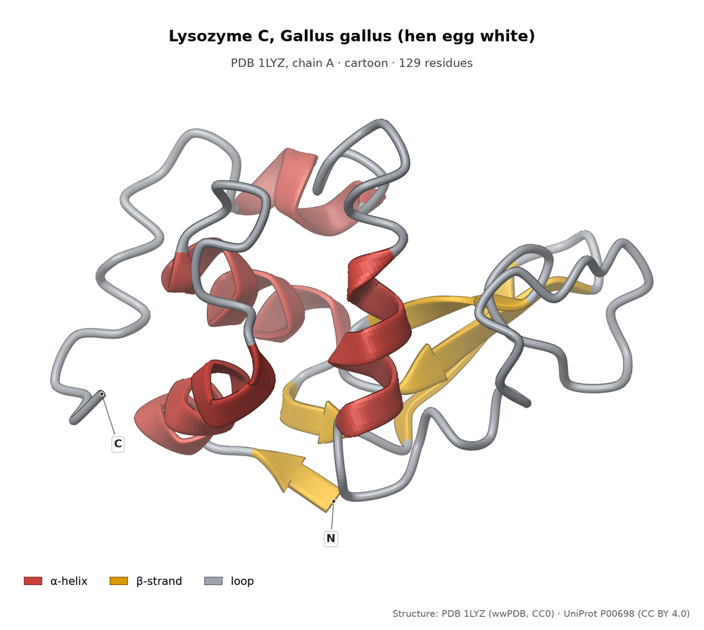
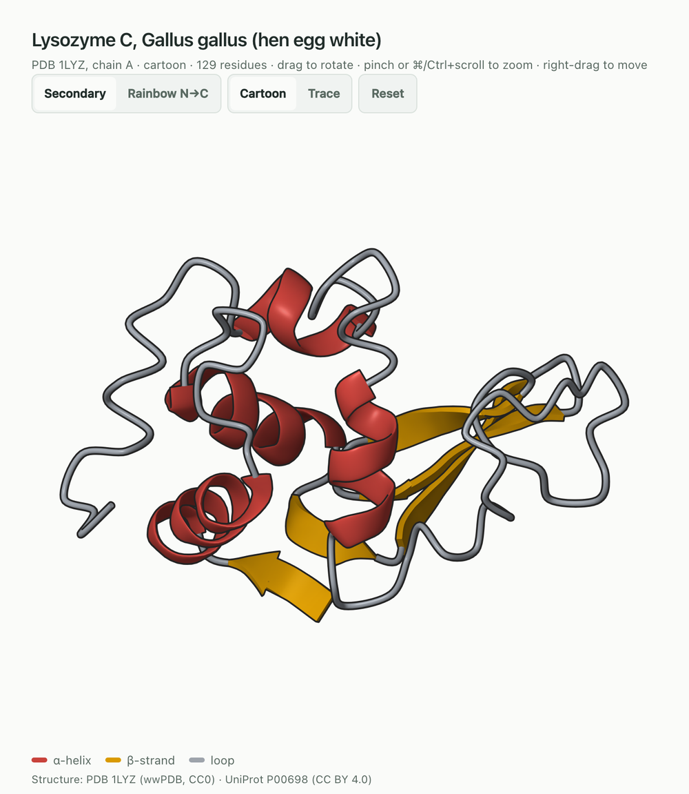
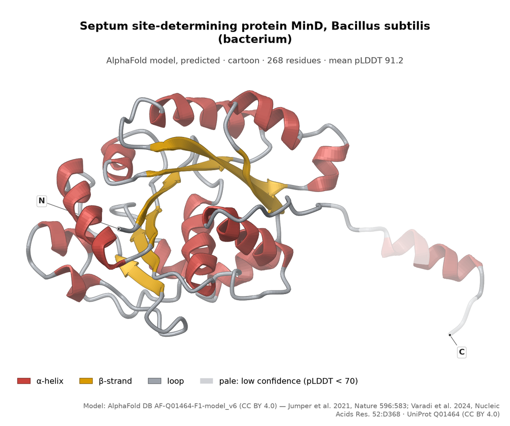
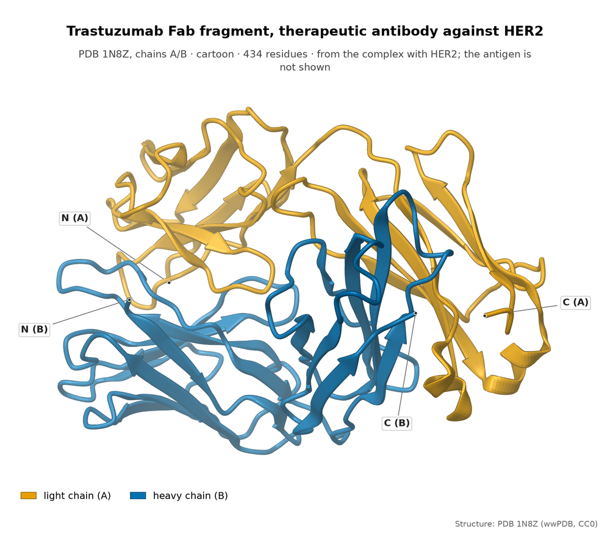
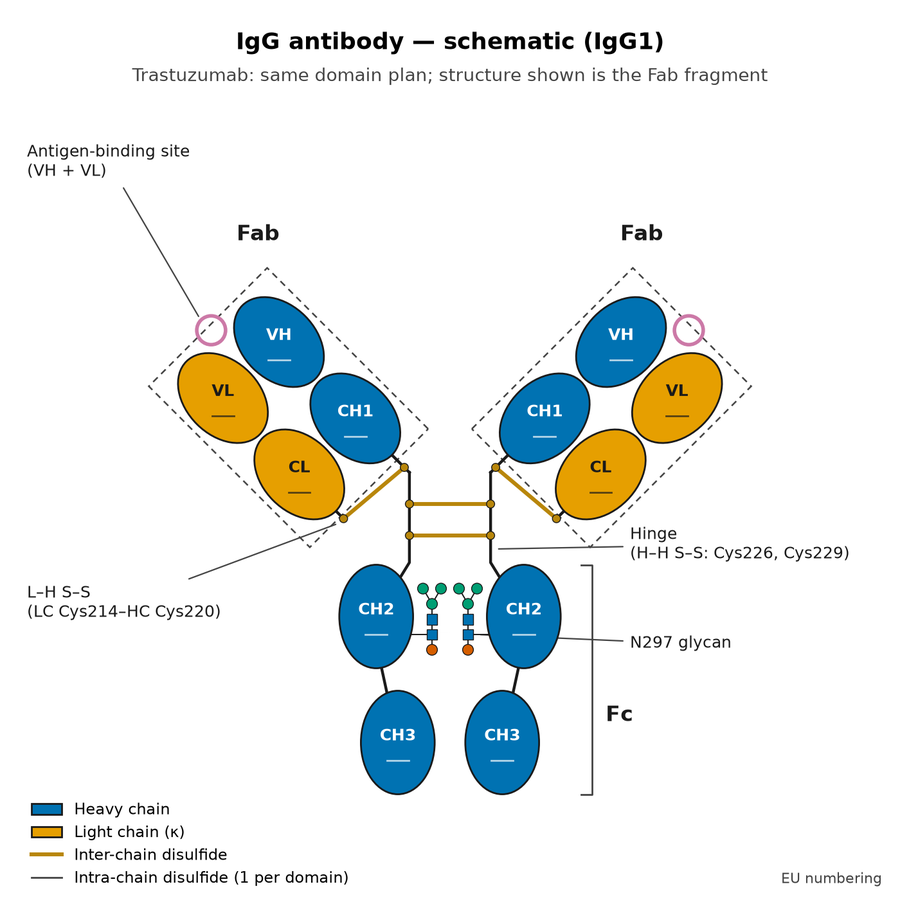
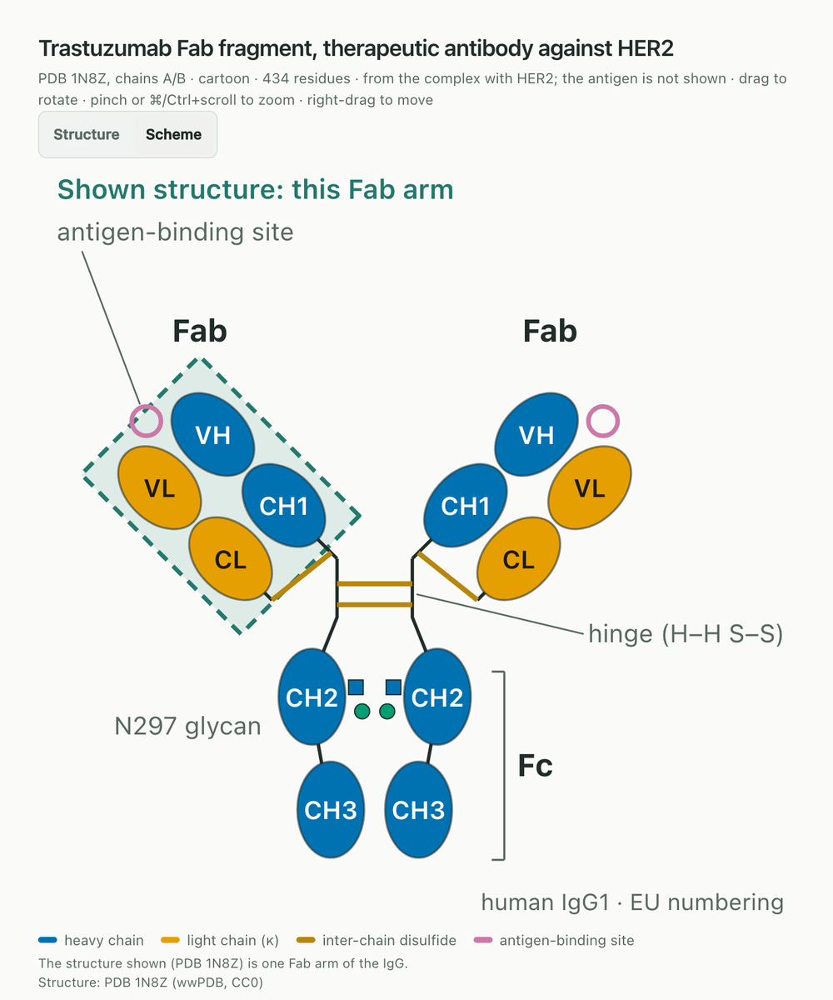

# Peptides and proteins

How to draw a peptide from its sequence, and what you get for an enzyme,
protein or antibody name: which entry is chosen, where the structure comes
from and what the picture shows. Peptides go through `generate_molecule`;
proteins, enzymes and antibodies have a tool of their own,
`generate_protein_or_antibody`.

## Peptides from a sequence

A sequence is built offline, also when no database knows it. Free termini
(H-…-OH) are the default.

| Prompt | Result |
|---|---|
| *"Draw the pentapeptide Ala-Trp-Lys-Ser-Gly"* |  |
| *"Draw the peptide with the one-letter sequence YGGFM"* |  |
| *"Draw cyclo(Arg-Gly-Asp-D-Phe-Val)"* |  |

What you can write:

- **Three-letter code** as the name: `Ala-Trp-Lys-Ser-Gly`, also lowercase
  (`ala-gly`).
- **D residues** with the prefix `D-`: `D-Ala-Gly`. Glycine has no D form.
- **Termini**: `H-` or `Ac-` at the start, `-OH` or `-NH2` at the end:
  `Ac-Ala-Gly-NH2`.
- **Cyclic peptides**: `cyclo(Arg-Gly-Asp-D-Phe-Val)`.
- **One-letter code** only with the prefix `peptide:` (`peptide:YGGFM`).
  Lowercase is a D residue (`peptide:cyclo(RGDfV)`), and `peptide:Ac-AG-NH2`
  sets termini. Without the prefix a short string is a name or a SMILES: "AGS"
  came back as ATPγS (PubChem: "Adenosine 5'-(trihydrogen diphosphate),
  P'-anhydride with phosphorothioic acid"), and "CCC" is propane.
- **Residues**: the 20 standard amino acids plus Orn, Nle, Nva, Sar and Abu.
- **Zwitterions**: "alanine zwitterion" charges the α-amino and α-carboxyl
  group and keeps the stereo of alanine.

Linear peptides of five or more residues are laid out as a stretched
backbone. The panel shows formula and molar mass computed from the structure;
the CAS number and PubChem title appear when PubChem holds a record for the
structure (YGGFM came back as "Metenkefalin", CAS 58569-55-4).

Names with a protecting group or ester (`Boc-Ala-OH`, `Asp-Phe-OMe`) and
trivial names ("Met-enkephalin") are looked up in the databases instead.

### Peptide limits

- At most 20 residues. Above that the error says: "a skeletal formula above 20
  residues is no longer legible (atom labels shrink below 10 px)".
- No disulfide bridges (`Cys-Gly-Cys` is drawn with two free SH groups), no
  side-chain isopeptide bonds (glutathione only by name), no phosphorylation.
- Residues such as Hyp, Aib, pGlu or Cit are not built. A sequence containing
  one is looked up by name; if no database knows it, the error names the
  residue ("'Hyp' (hydroxyproline) is not supported").

## Proteins, enzymes and antibodies

A protein has no readable skeletal formula. For a protein, enzyme or antibody
name, `generate_protein_or_antibody` draws a **cartoon** (ribbon diagram) of a 3D
structure instead: α-helices as ribbons, β-strands as flat arrows pointing to
the C-terminus, loops as a thin tube. It is built from the backbone atoms
(N, Cα, C, O) of the entry, coloured by secondary structure (or by chain when
there are several), and turned so that the longest extent lies horizontal.
Bound groups near the protein (heme, metal ions, bound inhibitors) are drawn
as sticks and spheres and named in the legend; water, buffer components,
simple salts and glycans are left out. The panel rotates; `generate_molecule`
and `generate_3d` give the same answer for a protein name. Title, subtitle and image always name
protein, organism and source.

The file in `~/ChemDraw-Output/proteine/` carries title, legend and the source
line:

In the panel the cartoon is rendered with [Mol*](https://molstar.org) and
turns with the mouse: drag to rotate, pinch or ⌘/Ctrl+scroll to zoom
(plain scrolling keeps scrolling the chat), right-drag to move. The buttons
switch the colouring (secondary structure; chain, when there are several;
rainbow N→C; pLDDT confidence for AlphaFold models) and between Cartoon and Trace; Reset returns
to the starting view. The picture area is a square as wide as the panel, at
most 720 px. **Export PNG** saves the cartoon as shown.

If the client has no WebGL, the panel shows a flat backbone trace in the
same area instead and says so ("3D cartoon unavailable here").

### Which entry you get

| Prompt | Entry the server chose |
|---|---|
| *"Draw lysozyme"*, *"Lysozym Huhn"* | Lysozyme C, *Gallus gallus* (hen egg white), PDB 1LYZ, 129 residues; the message names human lysozyme as the alternative |
| *"Draw human lysozyme"* | Lysozyme C, *Homo sapiens*, PDB 2NWD |
| *"Show me the 3D structure of trypsin"* | bovine trypsin, PDB 2PTN, 223 residues |
| *"Draw insulin"* | human insulin, PDB 3I40, chains A/B; porcine insulin (PDB 4INS) named as the alternative |
| *"Draw GFP"* | green fluorescent protein, *Aequorea victoria*, PDB 1GFL chain A |
| *"Draw RecA"* | Protein RecA, *Escherichia coli*, PDB 8GMU chain F, UniProt P0A7G6, 353 amino acids |
| *"Draw LacZ"*, *"Draw GroEL"* | beta-galactosidase (PDB 8RI8) and chaperonin GroEL (PDB 8BKZ), both *E. coli* |
| *"Draw RecA Thermus thermophilus"* | Protein RecA, *Thermus thermophilus* instead of *E. coli* |
| *"Draw MinD Bacillus subtilis"* | septum site-determining protein MinD, *Bacillus subtilis*, AlphaFold model of UniProt Q01464, 268 residues, mean pLDDT 91.2 |

- **Lab standards first.** A curated table picks the entry a lab usually means.
  Measured: hen lysozyme, bovine trypsin, bovine RNase A, BSA, bovine catalase,
  horse myoglobin, GFP, streptavidin, Taq polymerase, human insulin. The full
  list is in [tools.md](tools.md#draw).
- **Organism.** Add it to the name to get another source: "human lysozyme",
  "Lysozym Huhn", "RecA Thermus thermophilus", "HemA Bacillus subtilis".
- **Gene symbols** in bacterial style (`RecA`, `LacZ`, `GroEL`, `HemA`) go to
  UniProt's gene field, reviewed entries first. Without an organism you get
  the *E. coli* entry for all four. Written in capitals the input is read as a
  compound abbreviation, like `ATP` or `EDTA`, and may resolve to an unrelated
  compound.
- **When no entry carries the gene name for your organism**, the server takes
  the entry with the protein name the other entries carry and says so ("check
  that it is the protein you mean"). Such an entry can be an unreviewed
  (TrEMBL) one; check the name in the message.

### PDB or AlphaFold

An experimental structure from the PDB is used when one exists (chosen through
PDBe's best-structure list or the curated table). Otherwise the AlphaFold
model is used; the subtitle then says "AlphaFold model, predicted" with the
mean pLDDT, and residues below pLDDT 70 are drawn pale in the image file. The panel can colour an
AlphaFold model by confidence.

*"Draw MinD Bacillus subtilis"*: UniProt lists no PDB structure for this
protein (Q01464), so the AlphaFold model is drawn. The pale C-terminal stretch
is the part predicted with low confidence.

### Antibodies: "Fab fragment, not the full IgG"

Crystal structures of therapeutic antibodies are almost always of the **Fab
fragment**, the antigen-binding arm (light chain plus the first two domains
of the heavy chain), often bound to its antigen. For a known antibody such as
trastuzumab the picture therefore shows that Fab (PDB 1N8Z, chains A/B; the
antigen HER2 is left out), labelled as a Fab fragment. A second file shows the
**IgG domain scheme** of the whole antibody: heavy chain blue, light chain
orange, the inter-chain disulfides and the N297 glycan.

 

In the panel an antibody gets a **Structure | Scheme** switch. The scheme is
drawn in the panel itself; for an antibody with its own Fab structure it marks
which arm the structure shows:

Any other antibody name ("IgG", "anti-GFP", an unknown -mab) gets the
architecture of an intact human IgG1 (PDB 1HZH), labelled as the general
architecture and not as that antibody, plus the same scheme.

### Data sheet

*"What does lysozyme do and what is its EC number?"* goes to `lookup` with
topic `biochem`. For a protein it returns the UniProt entry chosen the same
way as the picture: name, organism, accession, length and mass of the mature
chain, EC number, function, the catalysed reaction, cofactors
and which structure is drawn. Details: [Data and lookup](data-and-lookup.md).

## Limits

- Proteins: no side chains. Bound groups (heme, metal ions, inhibitors) up to
  16 per structure, none from other copies of the crystal; water, buffer,
  simple salts and glycans are left out. One model, one copy of a multi-copy
  crystal, up to 3000 residues. 3₁₀- and π-helices are drawn as loops.
- Without network a protein is not drawn; the message keeps the reason.
- `batch_generate` and `compare_molecules` draw no proteins.
- Therapeutic antibodies are not listed in UniProt under their name, so their
  data sheet gives no length or mass.
- An AlphaFold model is a prediction, not a measured structure.
