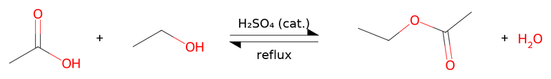
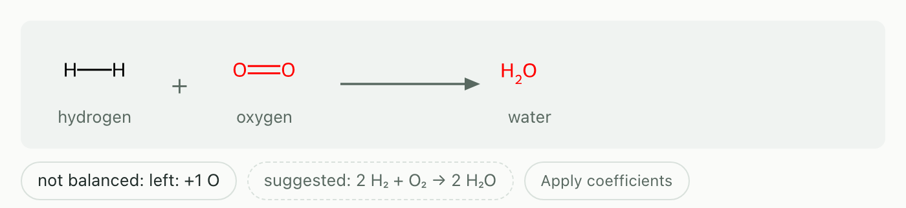
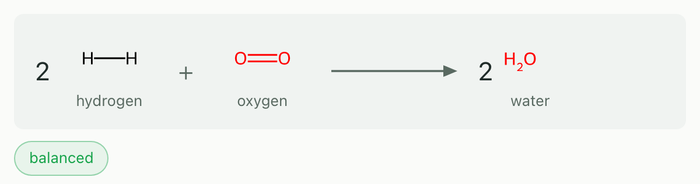
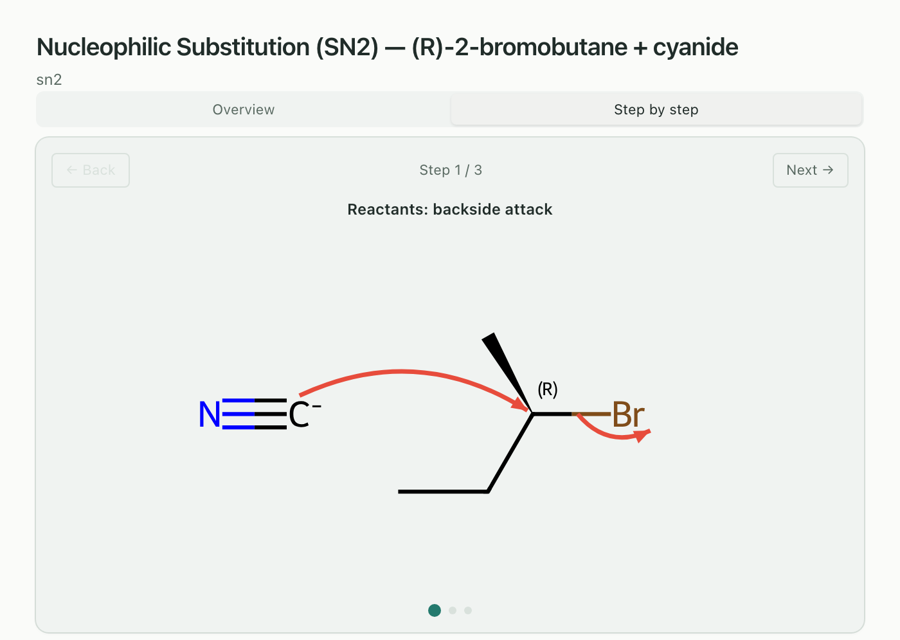
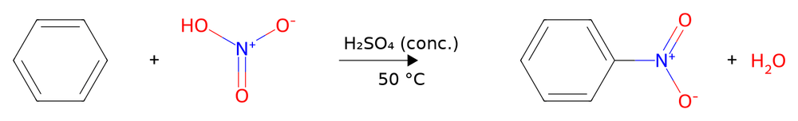
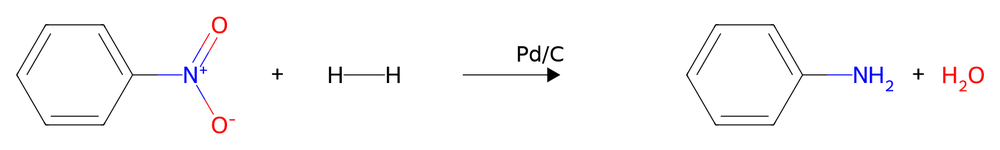
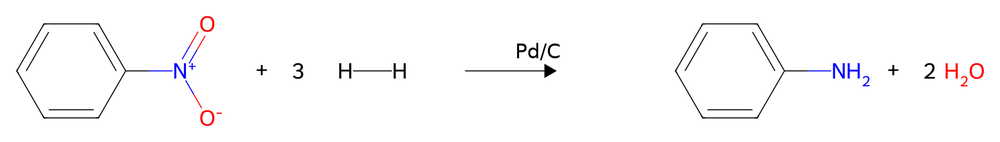
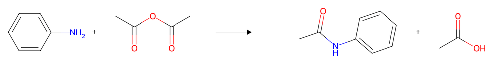
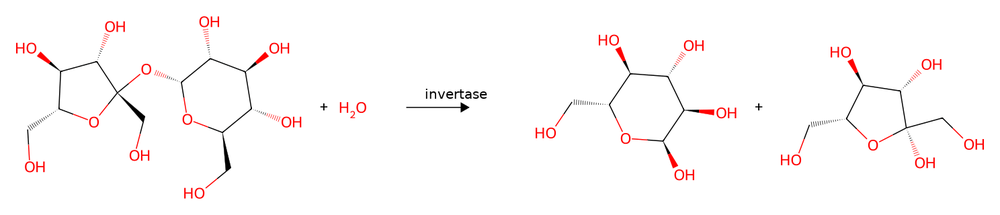

# Reactions and mechanisms

How to get a reaction scheme with conditions and a balance check, and a
curved-arrow mechanism you can step through. The tools are
`generate_reaction` and `generate_mechanism`. The worked example at the end
draws a three-step synthesis: benzene → nitrobenzene → aniline → acetanilide.

## Reaction schemes

*"Draw the esterification of acetic acid with ethanol, sulfuric acid as
catalyst, under reflux, as an equilibrium"*:

- **Species** are names or SMILES, as for single structures
  ([Drawing structures](drawing.md)). In the panel each one is labelled with
  its name; a SMILES is labelled with its formula.
- **Conditions** go above the arrow (`conditions`) and below it
  (`conditions_below`). Formula digits are subscripted: H2SO4 becomes H₂SO₄.
- **Arrows**: forward (→), equilibrium (⇌) or retrosynthetic (⇒, target on the
  left).
- **Files**: PNG and SVG in one folder per scheme under `~/ChemDraw-Output/`;
  add CDXML on request.

## Balance check and Apply coefficients

The panel counts atoms and charge on both sides of the drawn equation
(reagents in the arrow text do not count) and shows a badge:

- **balanced**: atoms and charge agree.
- **not balanced: …** with the difference, and a suggestion when whole-number
  coefficients exist. **Apply coefficients** redraws the scheme with them.
- **not balanced** without a suggestion when no coefficients can balance the
  species you drew, typically because a by-product is missing.

| Prompt | Panel |
|---|---|
| *"Draw H2 + O2 → H2O as a reaction scheme"* |  |
| click **Apply coefficients** |  |

The badge only checks; it never changes the drawing on its own. If you ask
for "a balanced equation", Claude often passes the coefficients itself, and
then there is no button to click.

## Mechanisms

*"Show the SN2 mechanism of (R)-2-bromobutane with cyanide step by step"*:

The panel has two modes: **Overview** lists every step below each other,
**Step by step** shows one at a time with **Back / Next** and step dots. The
drawings use your substrates:

| Family | What it takes | Steps |
|---|---|---|
| SN2 | a methyl, primary or secondary alkyl halide and one anionic nucleophile (OH⁻, CN⁻, I⁻, Br⁻, RO⁻, N₃⁻, RS⁻/HS⁻); a stereocentre is inverted | 3: reactants with backside attack, transition state, products (here (S)) |
| SN1 | a tertiary or benzylic halide with water, an alcohol or one of those anions | 6: reactants, leaving group departs, carbocation, nucleophilic attack, deprotonation of the oxonium ion, products |
| Fischer esterification | one carboxylic acid and one primary or secondary alcohol | 8, joined by ⇌; a second solvent molecule carries the proton instead of a free H⁺ |

When elimination competes, a note under the title says so and only the
substitution is drawn. For *t*-butyl bromide with water: "E1 elimination
competes: the carbocation can also lose a β-hydrogen and give an alkene, more
so on heating."

Outside these limits the tool refuses with the reason. An allylic halide in
SN1 gets: "the allyl cation is delocalised and the nucleophile attacks at both
ends (allylic rearrangement, two products); that is not drawn". For any other
reaction (Diels–Alder, aldol …) Claude draws the net scheme with
`generate_reaction` and says that the arrow mechanism is not drawn.

Mechanisms are drawn in the panel only and write no files; **Export PNG**
saves the current step, or in Overview all steps in one picture.

## Worked example: benzene to acetanilide

A three-step sequence from an introductory organic chemistry course, one
scheme per step. Every species is a plain name.

**Step 1, nitration.** *"Draw benzene + nitric acid → nitrobenzene + water,
conc. H2SO4 over the arrow, 50 °C below"*. The badge says **balanced**.

**Step 2, reduction.** *"Nitrobenzene + hydrogen → aniline + water, Pd/C"*.
Drawn with all coefficients 1, the badge says "not balanced: left: +1 O;
right: +2 H" and suggests "C₆H₅NO₂ + 3 H₂ → C₆H₇N + 2 H₂O":

**Apply coefficients** redraws it as balanced:

**Step 3, acetylation.** *"Aniline + acetic anhydride → acetanilide + acetic
acid"*. The badge says **balanced**.

Larger molecules work the same way. *"Draw the hydrolysis of sucrose to
alpha-D-glucose and beta-D-fructose with invertase over the arrow"* is
balanced as drawn:

## Limits

- One arrow per scheme. A sequence is one scheme per step.
- The balance check counts what is drawn. By-products and reagents you leave
  out make a step look unbalanced.
- Curved-arrow mechanisms: SN1, SN2 and Fischer esterification only, each
  within the substrate limits above. Only the substitution is drawn when
  elimination competes.
- Large species are drawn small in a scheme; the single-structure drawing is
  easier to read.
