# Tools in detail

What each tool of chemdraw-mcp does, the options on the drawing tools, the
`full` profile and the known limits. The short overview with example prompts is
the [tool table in the README](../README.md#tools).

Files go to `~/ChemDraw-Output/`.

- [Draw](#draw) · [Lab graphics](#lab-graphics) · [Look up](#look-up) ·
  [Calculate](#calculate) · [Anki](#anki)
- [Options on the drawing tools](#options-on-the-drawing-tools)
- [Profiles](#profiles)
- [Limitations](#limitations)

## Draw

**Structures.** `generate_molecule` takes a name (English, IUPAC, many German
trivial names) or SMILES. Names resolve through OPSIN, PubChem and NCI, with
English, counter-ion, form and rotation-sign spellings as fallbacks, and a
direct hit is cross-checked against the other source (free form over salt
unless the name says salt, the more defined stereo form wins); a pinned
identity test checks 25 inputs against their InChIKey, and family names such
as "xylene" return an isomer picker instead of a silent guess. The panel
shows properties, functional groups and the Lipinski rule of five, with
buttons for the data sheet, PNG export, an Anki card and a rotatable 3D
model; when the name was found under another spelling, a "Found as" line
says which. Fischer and Haworth projections and all-H drawings are a `view`
option and panel buttons.

<p align="center">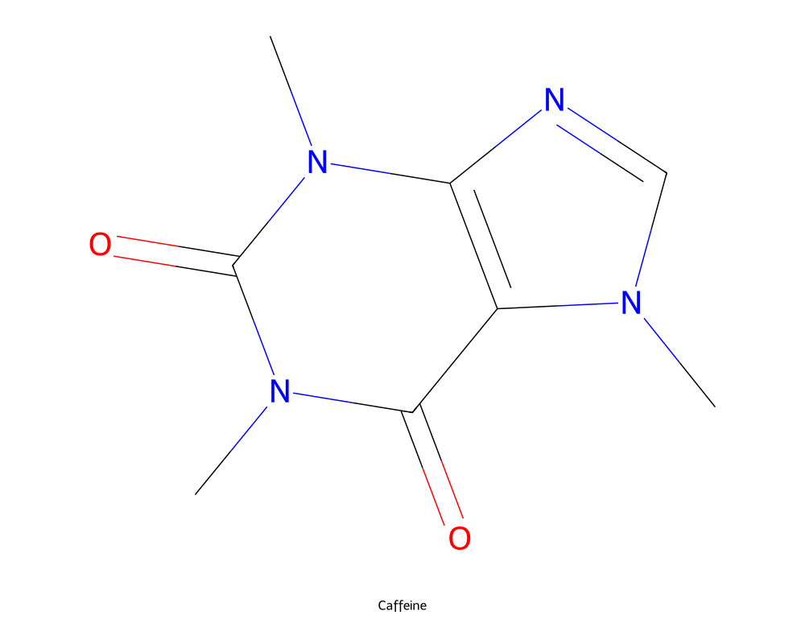</p>

**Comparisons.** `compare_molecules` draws two to four structures side by
side, keeps the shared scaffold neutral and highlights what differs:

<p align="center">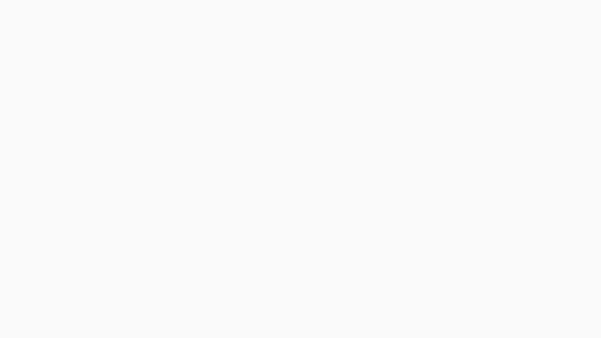</p>

**Reaction schemes.** `generate_reaction` draws reactants, products and
conditions above and below a forward (→), equilibrium (⇌) or retrosynthetic
(⇒) arrow; formula digits are subscripted (H2SO4 → H₂SO₄):

<p align="center">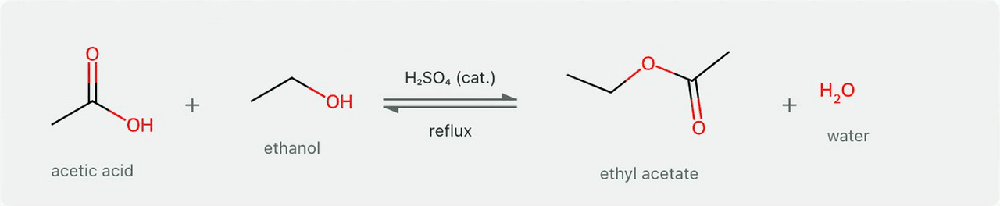</p>

**Mechanisms — three families, drawn with your molecules.** `generate_mechanism`
draws SN2, SN1 and Fischer esterification with the substrates you name, with
curved electron-flow arrows and **Next / Back** through the intermediates. SN2
takes a methyl, primary or secondary alkyl halide with one anionic nucleophile
(OH⁻, CN⁻, I⁻, Br⁻, RO⁻, N₃⁻, RS⁻/HS⁻) and inverts a stereocentre; SN1 takes a
tertiary or benzylic halide with water, an alcohol or one of those anions (an
allylic halide is refused: its cation gives two products); Fischer takes one
carboxylic acid and one primary or secondary alcohol; its steps are joined
by ⇌ and a second solvent molecule carries the proton instead of a free H⁺.
When elimination competes (a secondary halide with a strong or bulky base,
an SN1 cation with a β-hydrogen) a note under the title says so; only the
substitution is drawn. Anything outside these limits gets an error with the
reason. Other mechanisms are not available.

<p align="center">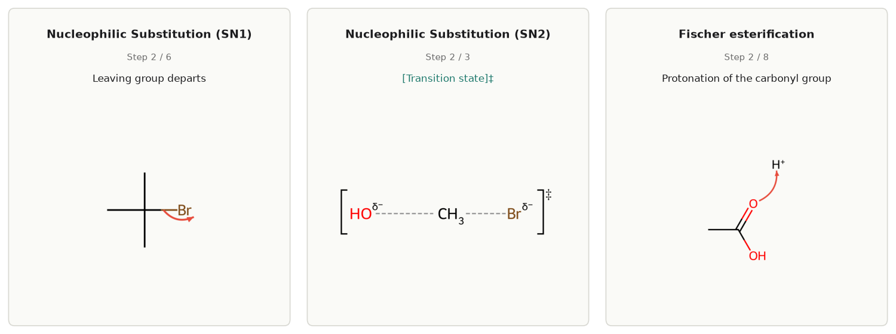</p>

**3D.** `generate_3d` embeds one conformer (ETKDGv3, then MMFF or UFF), opens a
ball-and-stick panel you drag to rotate and writes an SDF file; the same model
is behind the `3D` button of every molecule panel:

<p align="center">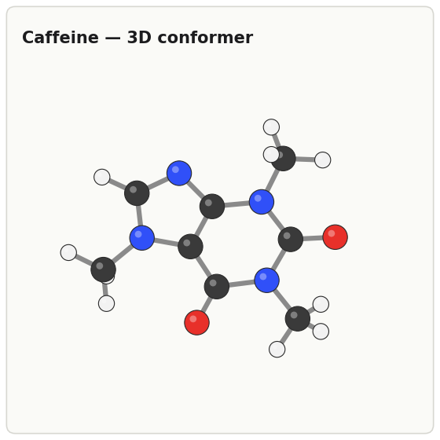</p>

## Lab graphics

These tools draw the numbers they are given — peak positions, Rf values, pKa
values. For a named compound the model supplies typical literature values;
check them before they go into a report.

**Spectra.** `generate_spectrum` draws IR, NIR, Raman, UV/Vis, fluorescence,
ORD, CD, ¹H/¹³C NMR and mass spectra with the axis conventions of each type
(inverted wavenumber axis for IR, ppm from right to left for NMR, bars for MS):

<p align="center">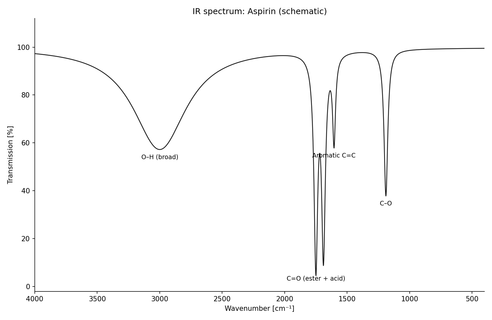</p>

**TLC plates.** `generate_tlc` draws start line, solvent front, one labelled
lane per application point, the Rf value at every spot, and the mobile phase
and detection as a caption:

<p align="center">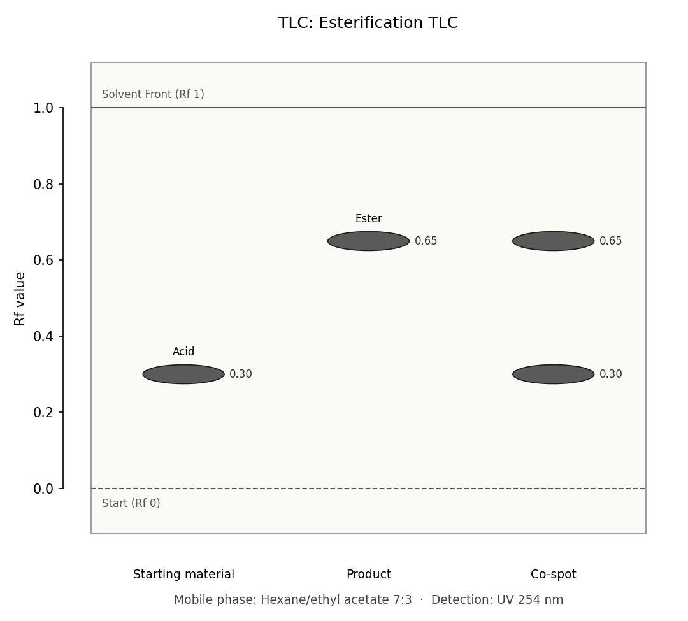</p>

**pH curves.** `generate_titration_curve` computes pH against titrant volume
from the exact charge balance and marks equivalence points, the buffer points
at half-equivalence and an optional indicator band.
`generate_species_distribution` plots the fraction of each protonation
species across pH 0–14:

<p align="center">
  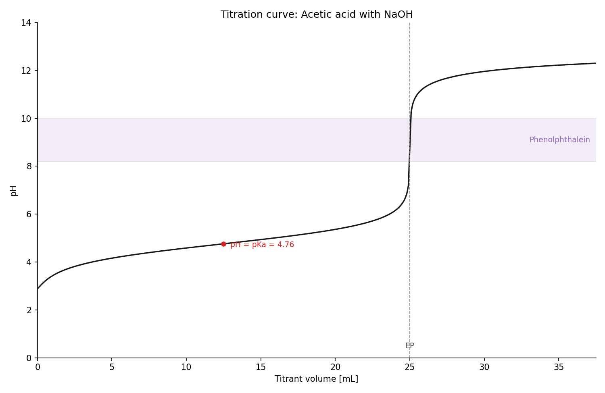
  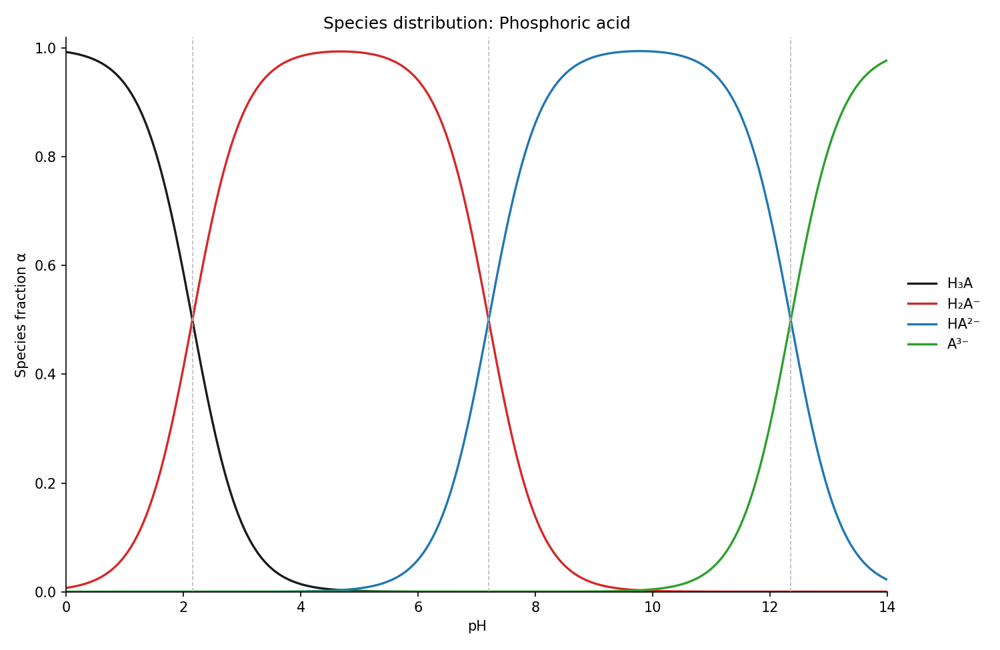
</p>

## Look up

- **`lookup`** answers one question as text, picked by `topic`: `properties`
  (formula, mass, CAS, InChIKey), `safety` (GHS statements, pictograms, signal
  word), `physical` (melting and boiling point, solubility, density), `biochem`
  (ChEBI classification, UniProt entries) or `pathway` (KEGG pathways).
- **`lookup_molecule_data`** builds the PubChem + GHS data sheet in the panel.
  The molecule panel's **Data** button calls it too, so a drawn structure is
  one click away from its data sheet.
- **`predict_spectrum`** lists the IR bands a structure should show (intensity,
  band shape), what a measured wavenumber could belong to, and how many ¹H
  signals to expect with their integral ratio. It is rule-based: no chemical
  shifts in ppm, and diastereotopic protons count as one signal.

<p align="center">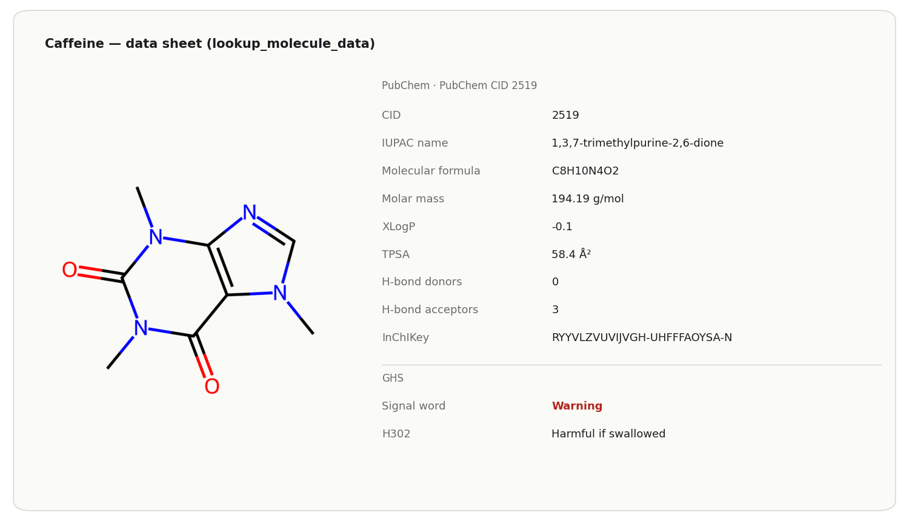</p>

Lookups need an internet connection. A missing value is not evidence that a
property or hazard is absent. The CAS number comes from PubChem's CAS section
(check digit verified, CAS Common Chemistry preferred, otherwise the majority
of sources); when the sources disagree evenly, the field stays empty.

## Calculate

**`calculate_ph`** covers weak and strong acids and bases, buffers (ratio and
capacity), buffer recipes down to weighable masses, and the ionised fraction of
a drug at a given pH. It solves the same exact charge balance that draws the
titration curve and prints the textbook approximation beside it; where the two
disagree, the answer says the approximation's assumptions no longer hold.
10⁻⁸ M HCl comes out at pH 6.98, not 8, and 2 M HCl at −0.30 with a note that
0–14 is no physical limit and that concentrated solutions follow activities,
not concentrations. You supply the pKa values.

<p align="center">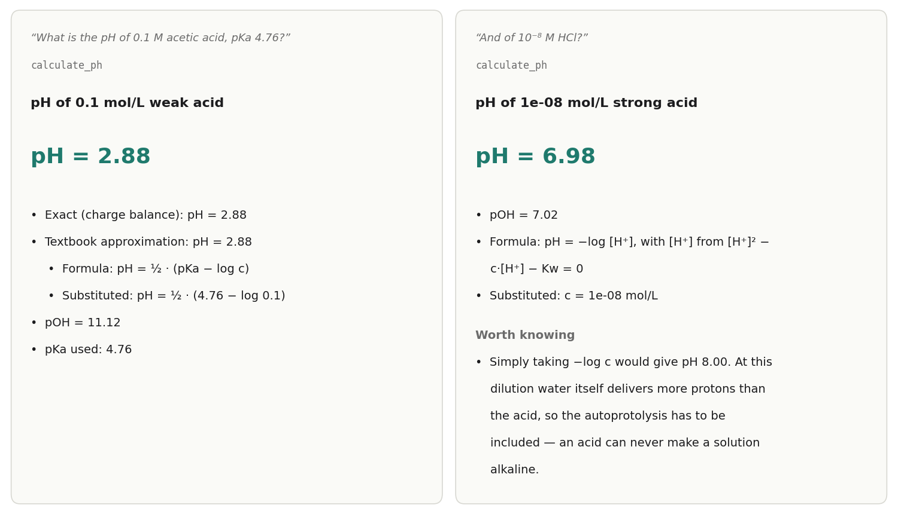</p>

## Anki

**`export_anki_deck`** writes a ready-to-import `.apkg` with rendered
structures: structure ↔ name drills (optionally both directions), cloze cards,
identity reactions and spectrum band assignments, with tags and
`Parent::Child` subdecks. Re-exporting a deck updates its cards instead of
duplicating them. With the AnkiConnect add-on the cards go straight into the
running Anki. `curated_deck_id` picks a small bundled starter deck instead of
your own cards. The molecule panel's **Add to Anki** button adds a single
structure card.

<p align="center">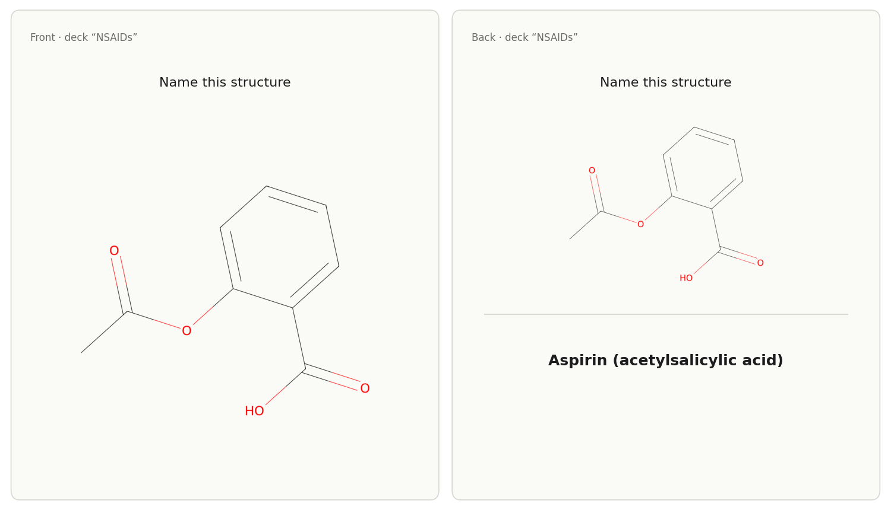</p>

## Options on the drawing tools

- **`formats`** — `["png","svg"]` by default; add `"cdxml"` for ChemDraw on
  `generate_molecule`, `generate_reaction` and `batch_generate`. Figures that
  are not structures (spectra, TLC plates) reject CDXML with an error.
- **`abbreviate_groups=True`** — draws common substituents as Ph, Bn, OMe, OAc,
  tBu, CO₂H, Boc, Ts, TBS.
- **`render_style`** — `"compact"` for small figures in a two-column layout,
  `"presentation"` for slides, `"grayscale"` for black-and-white printing.
  Empty means the default look.
- **`annotate_stereo=True`** — prints CIP descriptors (R/S, E/Z) on the drawing
  (`generate_molecule`, `batch_generate`).

## Profiles

| Profile | Tools | Contents |
|---|---|---|
| `mvp` (default) | 16, 12 with a panel | the five areas above |
| `full` | 23, 16 with a panel | adds a substrate-scope figure, a calibration curve, pharmacology curves and three more calculators |

The `full` profile adds:

- **`generate_scope_table`** — the substrate-scope figure of the methodology
  literature: general equation with conditions on top, products below with
  identifier, yield and optional ee/dr.
- **`generate_calibration_curve`** — least-squares line through your
  standards, unknowns read back off it, LOD/LOQ (DIN 32645); a sample outside
  the calibrated range is labelled as extrapolated.
- **`generate_pk_curve`** and **`generate_dose_response`** — plasma
  concentration over time (one-compartment model, single or repeated doses,
  therapeutic window) and the Hill curve with a competitive antagonist.
- **`calculate_solution`**, **`calculate_content`**,
  **`calculate_pharmacokinetics`** — what to weigh and how to dilute; content
  determinations with Grubbs test, t-test, fat characteristics and Karl
  Fischer; half-life, AUC, steady state and loading dose, each with the working.

<p align="center">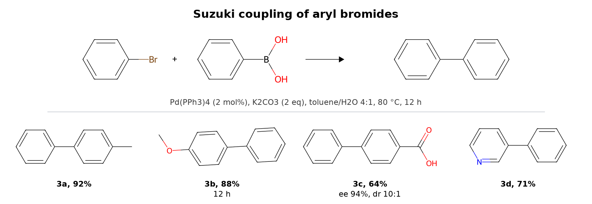</p>
<p align="center">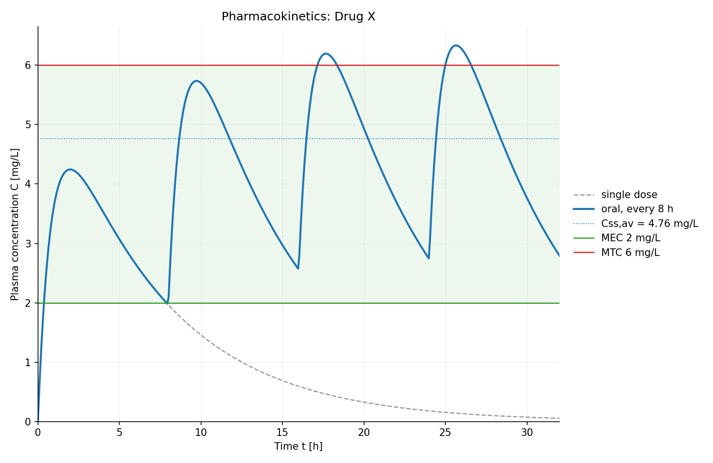</p>
<p align="center">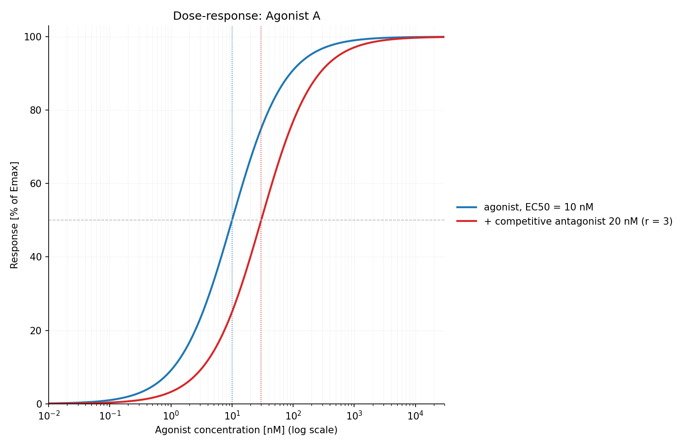</p>

To switch, set `CHEMDRAW_PROFILE` and restart the server:

```bash
uv run chemdraw-tool-server                         # mvp, the default
CHEMDRAW_PROFILE=full uv run chemdraw-tool-server   # all 23 tools
```

In Claude Desktop the two profiles are two connectors from one installation:
`chemdraw` (`mvp`) and `chemdraw-pharma` (`full`), registered by both the
extension bundles and `chemdraw-install`. Enable one per chat in the connector
menu — switching needs no restart; with both on, the model sees the default
tools twice. By hand, the entry's `"env": {"CHEMDRAW_PROFILE": "full"}` picks
the profile. An invalid profile name stops startup with an error. Two optional vault tools
(`search_vault`, `read_vault_entry`) appear only in the full profile and only
when `CHEMDRAW_VAULT_PATH` is set.

The server keeps a small log at `~/ChemDraw-Output/server.log` (rotated at 1 MB,
two older files kept). It records start-up, tool calls and errors; set
`CHEMDRAW_LOG_LEVEL=DEBUG` for the full trace, which includes the lookup URLs
and therefore the names you asked for.

## Limitations

- **Without Java, names need the internet.** OPSIN is skipped and names are
  resolved online through PubChem and NCI, so only names those databases index
  are found. With Java, systematic names with locants are parsed offline;
  a name without locants is cross-checked against PubChem when the network
  is there.
- **SMILES input is drawn locally, but looked up online.** Parsing and drawing
  need no network. When the network is there, `generate_molecule` and
  `batch_generate` ask PubChem for the name, CAS number and properties of the
  structure: first by InChIKey, and if PubChem does not know that key, the
  SMILES string itself is sent. Without a network the drawing still works and
  those fields stay empty.
- **Lab graphics are drawings of given numbers.** Spectra, TLC plates and pH
  curves show the values passed in. They measure nothing; values the model
  supplied from memory need checking. TLC spot `intensity` is a drawing hint,
  not densitometry.
- **Mechanisms are three families** (SN1, SN2, Fischer esterification), each
  within a stated substrate limit; allylic halides are refused, because the
  allyl cation gives two products and drawing one would be wrong.
- **3D is one conformer**, a plausible geometry to look at — not a
  conformational search and not an energy statement.
- **CDXML is a side path.** It is round-trip validated, but PNG and SVG are
  the primary outputs and the ones the pixel tests cover.
- **Claude Desktop often answers knowledge questions without a tool.**
  "What is the solubility of paracetamol?", expected IR bands, a pH number or
  "compare aspirin and paracetamol" were answered from memory in 0 of 3 chats
  each (measured 2026-11-03), even though a tool fits. Drawing and figure
  requests are not affected. Adding "use ChemDraw" to the prompt made Desktop
  call `calculate_ph`, `lookup` and `compare_molecules` (2 of 2 chats each).
- **The extension targets macOS and Linux.** Windows is untested.
